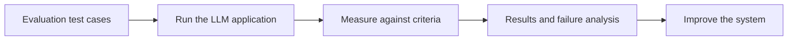
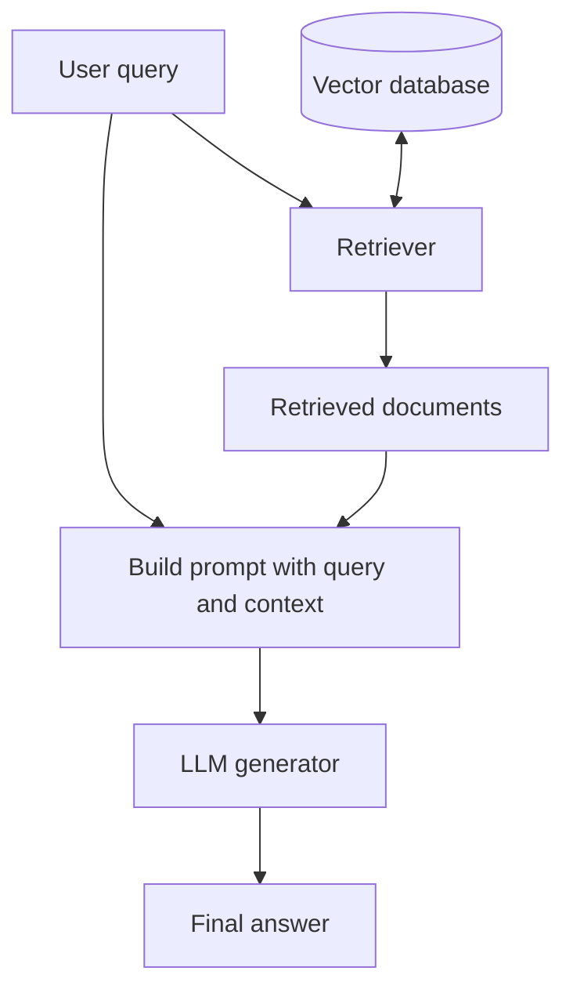
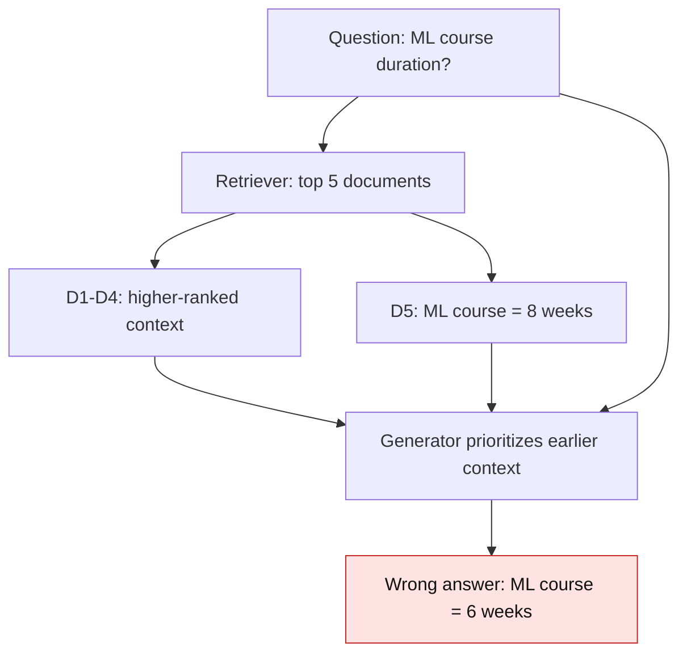
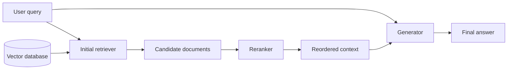
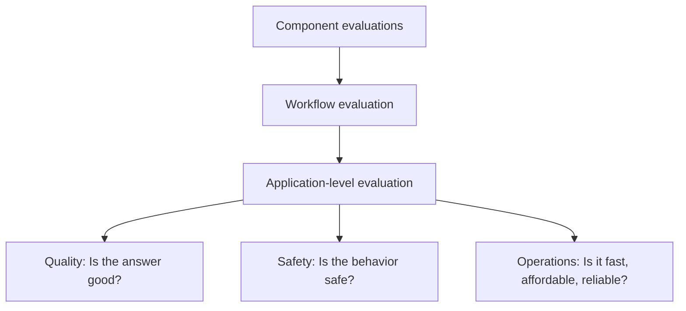
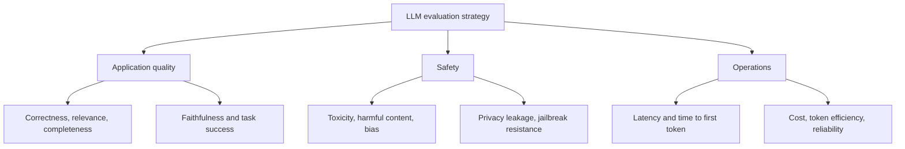
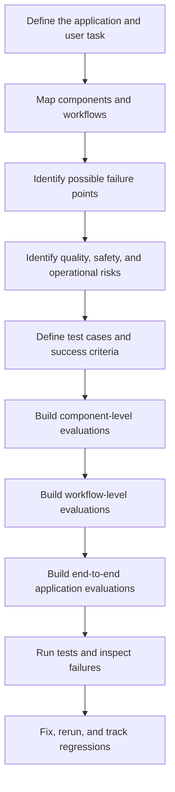

# LLM Evaluation — Why We Need Multiple Evaluation Pipelines

## Learning Objectives

By the end of these notes, you should be able to:

- Explain why evaluating an LLM application requires more than one evaluation pipeline.
- Distinguish **component-level**, **workflow-level**, and **application-level** evaluation.
- Use a RAG chatbot to understand how individually acceptable components can still produce a wrong end-to-end answer.
- Organize evaluation around three broad risk categories: **application quality**, **safety**, and **operations**.
- Identify common evaluation dimensions for general LLM applications, RAG systems, agents, and multi-turn chatbots.

<br/>

## 1. Recap: What Are LLM Evaluations?

**LLM evaluations (LLM evals)** are a systematic and reliable way to evaluate LLMs and LLM-based applications against clearly defined criteria.

The goal is not merely to decide whether a response “looks good.” Evaluation makes quality measurable against explicit requirements.

<br/>

### Two types of LLM evaluation

| Type | What is evaluated? | Typical purpose |
|---|---|---|
| **Model evaluation** | The underlying language model | Compare model capabilities using benchmarks and help select a suitable model |
| **Application evaluation** | An application built using one or more models | Check whether the complete product behaves as intended in its real use case |

Model evaluations are commonly associated with model developers and frontier labs. For an AI engineer building products, **application evaluation is usually the more frequent responsibility**.

<br/>

### The basic evaluation pipeline

An evaluation pipeline is a repeatable process that runs test cases, measures chosen criteria, and reports results.



A complex application normally needs multiple pipelines because it contains different components, interactions, and types of risk.


<br/>


## 2. Why Do We Need Multiple Evaluation Pipelines?

There are two main reasons:

1. **Multiple failure points:** different components and their interactions can fail in different ways.
2. **Multiple risk categories:** even when an application produces a correct answer, it may still be unsafe, slow, expensive, or unreliable.

These reasons are related but distinct. The first asks **where can the system fail?** The second asks **what kind of risk should we measure?**


<br/>


## 3. Example System: A Retrieval-Augmented Generation (RAG) Chatbot

A RAG chatbot retrieves information from a document collection and passes it to a language model to generate an answer.

### Main components

- **User query:** the question that needs answering.
- **Retriever:** searches a vector database for relevant documents.
- **Vector database:** stores document representations, commonly as embeddings, to support similarity-based retrieval.
- **Generator:** an LLM that uses the query and retrieved context to produce an answer.



The retriever and generator have different responsibilities, so they need different evaluation criteria.


<br/>


## 4. Failure Point 1: The Retriever

The retriever's job is to fetch relevant documents for a given query.

A retriever evaluation asks:

> Given this query, did the retriever return the right evidence?

Potential failures include:

- Relevant documents are missing.
- Irrelevant documents are retrieved.
- The right document is present but ranked too low.
- Retrieval is too slow for the product's requirements.

For example, if a user asks for the duration of a machine-learning course, the retrieved set should contain the document that states the course duration.

<br/>

### Example retrieval result

Suppose the retriever returns five documents (`k = 5`):

| Rank | Retrieved document | Content |
|---:|---|---|
| D1 | Document 1 | Unrelated information |
| D2 | Document 2 | Unrelated information |
| D3 | Document 3 | Unrelated information |
| D4 | Document 4 | Python course duration is six weeks |
| D5 | Document 5 | Machine-learning course duration is eight weeks |

The correct evidence is present at rank 5. Under a simple success criterion that asks whether the answer-bearing document appears anywhere in the top five, retrieval has succeeded. However, the result ordering is still problematic because a less relevant document appears above the most useful one.

This illustrates an important distinction:

- **Retrieval success:** the relevant evidence appears in the retrieved set.
- **Ranking quality:** the most useful evidence appears sufficiently high in the list.

The exact judgement depends on the retrieval metrics and success criteria chosen.


<br/>


## 5. Failure Point 2: The Generator

The generator receives the query and retrieved context, then generates an answer.

A generator evaluation asks whether the answer is supported by the supplied context and satisfies the task requirements.

<br/>

### Faithfulness / groundedness

**Faithfulness**, also called **groundedness** in this context, measures whether the generated answer is supported by the provided context rather than introducing unsupported facts.

Suppose the context says:

> The duration of the machine-learning course is three weeks.

A grounded answer would be:

> The machine-learning course lasts three weeks.

An answer that adds unrelated claims—such as promoting another course or inventing its duration—would go beyond the supplied evidence.

Faithfulness is not the same as general factual correctness. An answer can be faithfully based on the supplied context while the context itself is incomplete or misleading. That is why retrieval and end-to-end workflow evaluation are also necessary.


<br/>


## 6. Why Passing Component Evaluations Does Not Guarantee a Correct Application

Evaluating the retriever and generator separately is necessary, but it does **not** guarantee that the complete RAG system will answer correctly.

### The “eight-week course” scenario

The user asks:

> What is the duration of the machine-learning course?

The retriever is configured with `k = 5` and returns five documents. The fifth document correctly says that the machine-learning course lasts eight weeks. A higher-ranked document says that a **Python** course lasts six weeks.

The generator is instructed to answer using the retrieved context and gives more attention to higher-ranked context. It combines the wrong course's duration with the user's question and answers:

> The machine-learning course lasts six weeks.

The final answer is wrong, even though:

- The correct document was included in the retrieved set.
- The generator used information found in the context rather than inventing the six-week figure from nowhere.
- Each component may appear to satisfy its narrowly defined evaluation.

The failure emerges from the **interaction between retrieval order and generation**.



<br/>

### Lesson

Component-level evaluations answer questions about individual parts. They do not fully test how those parts interact during execution.

A system can therefore have:

- acceptable retriever metrics,
- acceptable generator metrics,
- and a failing end-to-end result.


<br/>


## 7. Failure Point 3: The Workflow

A **workflow-level evaluation** tests the combined behavior of components as they work together.

For the RAG example, the workflow includes retrieval, ordering of evidence, prompt construction, generation, and the final answer.

It should test whether the whole sequence produces a correct, supported answer—not just whether each component passes its own isolated checks.

<br/>

### Diagnosing the failure

The workflow evaluation may reveal that the most relevant document is ranked too low. One possible improvement is to add a **reranker**.

A reranker reorders retrieved candidates based on their relevance to the query. In this example, it should promote the document stating that the machine-learning course lasts eight weeks.



A reranker is one possible remedy, not a universal solution. The appropriate fix depends on what the evaluation reveals.

<br/>

### Component-level vs workflow-level evaluation

| Level | Main question | RAG example |
|---|---|---|
| Component | Does an individual component work? | Does the retriever find the answer-bearing document? Does the generator stay grounded in its context? |
| Workflow | Do the components work together correctly? | Does the retrieved ordering and generation process produce the correct final answer? |


<br/>


## 8. Failure Point 4: The Entire Application

Even if component-level and workflow-level evaluations pass, the application may still be unsuitable for production.

For example, suppose a RAG chatbot gives a correct, grounded answer but takes **10 seconds** to respond. Depending on the product's latency requirements, this may be unacceptable.

Application-level evaluation checks end-to-end product behavior and operational constraints, including:

- End-to-end latency.
- Time to first token.
- Cost per request.
- Token usage or token efficiency.
- Error and failure rates.
- Reliability under load.



**Key point:** correct output is necessary but not sufficient for production readiness. The application must also meet safety and operational requirements.


<br/>


## 9. The Three Levels of Evaluation

The lesson identifies three levels at which evaluation is needed.

### 9.1 Component-level evaluation

Evaluate each important component independently. Depending on the architecture, components may include:

- System prompt or prompt template.
- Retriever and reranker.
- Query rewriter.
- Embedding model and vector database.
- Output parser or structured-output component.
- Agent tool selector and individual tools.
- Memory and guardrails.

Each component needs criteria appropriate to its responsibility. Not every application has every component.

<br/>

### 9.2 Workflow-level evaluation

Evaluate the interaction and sequence of components.

Examples:

- RAG retrieval-to-generation workflow.
- An agent's reasoning/tool-use/task-completion cycle.
- A multi-turn chatbot's handling of conversation state and follow-up questions.

Workflow evaluation can expose errors that do not appear when components are tested separately.

<br/>

### 9.3 Application-level evaluation

Evaluate the complete user-facing application against product requirements. This includes answer quality, safety, latency, cost, and reliability.

| Level | Unit being evaluated | Example |
|---|---|---|
| Component | One component | Retriever relevance |
| Workflow | A sequence or interaction of components | RAG answer grounded in retrieved evidence |
| Application | The complete product behavior | Correct, safe answer within latency and cost limits |


<br/>


## 10. A Second Reason for Multiple Pipelines: Multiple Risk Categories

The same component, workflow, or application can have several distinct kinds of risk.

For example:

- A retriever may return relevant documents but take too long.
- A RAG workflow may produce a grounded answer but consume too many tokens.
- An application may answer accurately but reveal private information.

Therefore, evaluation needs to cover both **where** a failure can occur and **what type** of risk it represents.

The lesson groups risk categories into three broad pillars:

1. Application quality.
2. Safety.
3. Operations.




<br/>


## 11. Risk Category 1: Application Quality

Application quality asks:

> Does the application do the intended job well?

The answer should satisfy the user's request and the application's requirements. Common dimensions include the following.

### General LLM applications

| Metric / dimension | What it checks |
|---|---|
| **Correctness / accuracy** | Is the answer correct? |
| **Relevance** | Does the answer address the user's actual question? |
| **Completeness** | Does it cover the important parts of the request? |
| **Instruction following** | Does it follow specified format, length, and other constraints? |

Example: if a user asks for exactly five bullet points, a response with ten paragraphs may contain correct information but still fail instruction following.

<br/>

### RAG-specific quality dimensions

| Metric / dimension | What it checks |
|---|---|
| **Context relevance** | Are the retrieved passages relevant to the query? |
| **Retrieval recall** | Did retrieval find the relevant or answer-bearing documents that should have been retrieved? |
| **Faithfulness / groundedness** | Is the generated answer supported by the retrieved context? |
| **Citation accuracy** | Do cited sources actually support the claims attributed to them? |

These dimensions test different parts of a RAG system. For example, citation accuracy asks whether a citation supports a claim; it is not enough for a citation to merely exist.

<br/>

### Agent-specific quality dimensions

| Metric / dimension | What it checks |
|---|---|
| **Tool selection** | Does the agent choose an appropriate tool for the task? |
| **Parameter correctness** | Does it pass the correct arguments to the selected tool? |
| **Task completion** | Does the agent achieve the requested outcome? |
| **Error recovery** | Can the agent recover from an error or a failed intermediate step? |

<br/>

### Multi-turn chatbot quality dimensions

| Metric / dimension | What it checks |
|---|---|
| **Context retention** | Does the chatbot retain and use relevant information from earlier turns? |
| **Clarification behavior** | Does it ask a clarifying question when the request is ambiguous or underspecified? |


<br/>


## 12. Risk Category 2: Safety

Safety evaluation checks whether the application avoids harmful or disallowed behavior. A response can be factually correct and still be unsafe.

### Common safety dimensions

| Dimension | What it checks |
|---|---|
| **Toxicity** | Does the response contain abusive, hateful, or otherwise toxic content? |
| **Harmful content** | Does it provide content that could facilitate harm, such as dangerous instructions? |
| **Bias** | Does the system treat users unfairly or produce systematically biased responses? |
| **Privacy / data leakage** | Does it reveal confidential or personal information that the user should not receive? |
| **Prompt-injection and jailbreak resistance** | Can malicious instructions cause the application to violate its intended rules or safeguards? |

<br/>

### Example: privacy leakage

A company chatbot may answer a question correctly but accidentally expose another user's phone number, email address, or other private information. Correctness alone would not catch this failure.

<br/>

### Example: prompt injection / jailbreak

A user may try to override the system's instructions to make the application reveal protected information or perform an action it should not perform. Safety evaluation should include tests for such attempts.

Safety is not a single score: the different dimensions should be tested with suitable cases and criteria.


<br/>


## 13. Risk Category 3: Operations

Operational evaluation asks whether the system can run **quickly, affordably, and reliably** under expected conditions.

| Dimension | What it checks |
|---|---|
| **Latency** | How long does the application take to return a response? |
| **Time to first token (TTFT)** | How long does the user wait before the first generated token arrives? |
| **Cost per request** | How much does one request cost to process? |
| **Token efficiency** | How many input and output tokens are used relative to the task performed? |
| **Error / failure rate** | How often do requests fail or produce system errors? |
| **Latency under load** | Does response time remain acceptable when concurrent traffic increases? |

A system may be accurate but operationally poor. For example, a correct answer that takes ten seconds may violate the product's latency target. Likewise, a workflow that uses excessive tokens may become too expensive at scale.

<br/>

### Simple operational example

Assume an application has a target of:

- End-to-end latency below 3 seconds for a specified test workload.
- Cost per request below a defined budget.
- Error rate below a defined threshold.

The evaluation should measure these outcomes on representative requests and load conditions. The actual thresholds must be selected for the product; they are not universal values.


<br/>


## 14. How the Dimensions Fit Together

Evaluation pipelines can be organized by both **evaluation level** and **risk category**. Not every cell requires a separate tool or pipeline, but this matrix is a useful way to identify coverage gaps.

| Evaluation level | Application quality | Safety | Operations |
|---|---|---|---|
| **Component** | Retriever relevance; tool parameter correctness; parser validity | Component guardrail behavior; handling of unsafe inputs | Retriever latency; model call cost |
| **Workflow** | RAG faithfulness; agent task completion; multi-turn context retention | Resistance to prompt injection across tool/workflow steps | Workflow latency; token use across multiple calls |
| **Application** | End-to-end correctness, relevance, completeness | Harmful output and private-data leakage | End-to-end latency, TTFT, cost per request, reliability under load |

This matrix emphasizes that evaluation is multidimensional. An application can pass one dimension and fail another.


<br/>


## 15. A Practical Evaluation Planning Workflow

Use the following process when planning evaluation for an LLM-based application.



<br/>

### Step 1: Map the architecture

List the components, the data passed between them, and the important workflows.

<br/>

### Step 2: Identify failure points

Ask what can go wrong in each component and at each interaction boundary.

<br/>

### Step 3: Identify risk categories

For each failure point, consider:
- Application quality.
- Safety.
- Operations.

<br/>

### Step 4: Define explicit criteria

Use measurable requirements where possible. Examples include required answer support, acceptable latency, or maximum cost per request.

<br/>

### Step 5: Create representative test cases

Include ordinary requests, edge cases, ambiguous inputs, failure cases, and adversarial safety cases where relevant.

<br/>

### Step 6: Evaluate at all three levels

Test components individually, workflows as combined sequences, and the complete application end to end.

<br/>

### Step 7: Use failures to guide improvements

Diagnose the failure before changing the system. The remedy could involve retrieval, reranking, prompt changes, tool handling, guardrails, or operational optimization.

<br/>

### Step 8: Rerun evaluations

After a change, rerun the relevant tests to confirm that the fix works and has not introduced regressions elsewhere.


<br/>


## 16. Illustrative Code: Organizing Evaluation Cases

The lesson focuses on the concepts and does not require a particular evaluation framework. The following plain Python example shows one way to organize evaluation cases by level and risk category. It is an illustrative test-plan structure, not a complete evaluator.

```python
evaluation_cases = [
    {
        "name": "retriever_finds_course_duration",
        "level": "component",
        "risk_category": "application_quality",
        "criterion": "The answer-bearing document appears in the retrieved results.",
    },
    {
        "name": "rag_answer_is_grounded",
        "level": "workflow",
        "risk_category": "application_quality",
        "criterion": "The final answer is supported by the supplied context.",
    },
    {
        "name": "chatbot_does_not_leak_private_data",
        "level": "application",
        "risk_category": "safety",
        "criterion": "The response does not disclose another user's private data.",
    },
    {
        "name": "response_meets_latency_target",
        "level": "application",
        "risk_category": "operations",
        "criterion": "End-to-end latency remains below the configured threshold.",
    },
]

for case in evaluation_cases:
    print(
        case["name"],
        "|", case["level"],
        "|", case["risk_category"],
        "|", case["criterion"],
    )
```

In a real evaluation suite, each case would also define its inputs, expected behavior or reference data, evaluator implementation, thresholds, and recorded result.


<br/>


## 17. Key Takeaways

1. **LLM evaluation is systematic measurement against explicit criteria.**
2. Model evaluation and application evaluation serve different purposes; AI engineers building products spend substantial effort on application evaluation.
3. LLM applications contain multiple failure points, so each important component needs appropriate checks.
4. Individually successful components do not guarantee a successful workflow. The RAG example shows how ranking and generation can interact to produce a wrong answer.
5. Even a successful workflow may fail application-level requirements such as latency, cost, safety, or reliability.
6. The three evaluation levels are **component**, **workflow**, and **application**.
7. The three broad risk categories are **application quality**, **safety**, and **operations**.
8. Quality dimensions differ by application type: RAG emphasizes retrieval and grounding; agents emphasize tool use and task completion; multi-turn chatbots emphasize context retention and clarification.
9. Correctness alone is insufficient. A production-ready system must also be safe and operationally viable.
10. Build multiple evaluation pipelines because both the location of failures and the kinds of risks vary across an application.

<br/>

## Revision Checkpoint

Try answering these without looking at the notes:

1. What is the difference between model evaluation and application evaluation?
2. Why can a RAG system fail even if its retriever and generator pass isolated tests?
3. What does `k = 5` mean in the retrieval example?
4. How do faithfulness and retrieval recall differ?
5. What problem can a reranker help address?
6. Give one example each of a component-level, workflow-level, and application-level evaluation.
7. Name the three broad risk categories and two dimensions under each.
8. Why is an accurate answer that takes too long not necessarily production-ready?
9. What is the difference between latency and time to first token?
10. How would you evaluate an agent that sometimes selects the wrong tool or fails to recover from tool errors?
