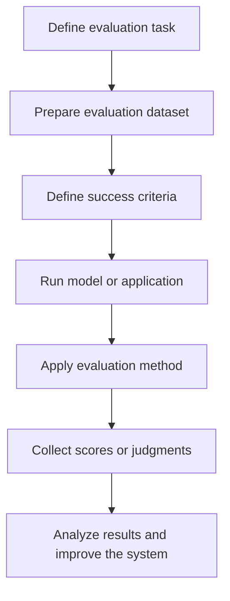
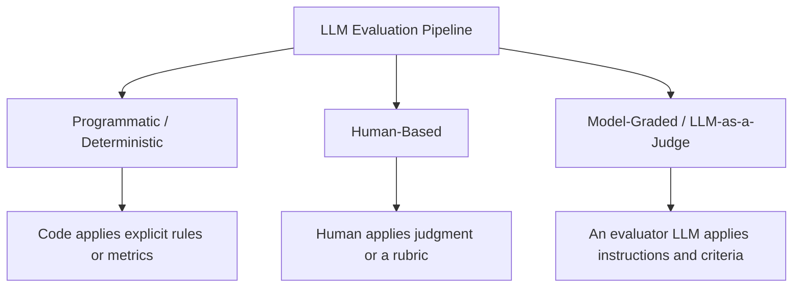

# 4.1. What Is an Evaluation Method?

## Learning Objectives

By the end of this section, you should be able to:

- Define an LLM evaluation method.
- Explain how an evaluation method fits into an evaluation pipeline.
- Distinguish programmatic, human-based, and model-graded evaluation.
- Identify the evaluation method used in a practical example.
- Explain why the evaluator, dataset, and evaluation criteria are separate parts of an evaluation setup.

<br/>

## 1. What Is an LLM Evaluation Method?

An **LLM evaluation method** is the procedure used to inspect a model's output and produce a judgment about its quality or correctness.

In simple terms, it answers:

> **Who or what evaluates the output, and how is the judgment produced?**

An evaluation pipeline is built to determine whether a model component, workflow, or complete application is working as expected. The evaluation method is the mechanism that carries out the assessment.

For example, an application may generate a response to a user's question. An evaluation method could:

- Compare the response with an expected answer using Python.
- Ask a human evaluator to judge whether the response is helpful.
- Ask another LLM to grade the response using a defined rubric.

Each approach can assess output quality, but the evaluator and the procedure are different.

<br/>

## 2. How an Evaluation Method Fits into an Evaluation Pipeline

An evaluation pipeline is the overall process used to assess a model or application. The evaluation method is the part that performs the judgment.

A simplified pipeline looks like this:



The dataset and success criteria provide the information needed for evaluation. The evaluation method applies the criteria to outputs and produces judgments or scores.

<br/>

### Important distinction

- **Evaluation dataset:** The examples used to test the system.
- **Success criteria or rubric:** The definition of what counts as good performance.
- **Evaluation method:** The procedure or evaluator that applies the criteria.
- **Evaluation result:** The score, label, judgment, or other measurement produced.

These are related, but they are not the same thing.

<br/>

## 3. The Three Core Evaluation Methods

The lesson groups evaluation methods by **who or what executes the evaluation**.



<br/>

### 3.1 Programmatic / Deterministic Evaluation

In programmatic evaluation, code performs the evaluation using explicit rules, calculations, or comparisons.

It is suitable when success can be measured with a clearly defined metric or rule.

Examples include:

- Calculating classification accuracy.
- Checking whether a required field exists in a structured response.
- Comparing an output with a known expected value.
- Calculating retrieval metrics such as Recall@K.

**Example:** An email classifier predicts whether a message concerns billing, a technical issue, or a general issue. Python compares the predictions with known labels and calculates accuracy.

```python
from sklearn.metrics import accuracy_score

y_true = ["billing", "technical", "general", "billing", "general"]
y_pred = ["billing", "technical", "billing", "billing", "general"]

accuracy = accuracy_score(y_true, y_pred)
print(f"Accuracy: {accuracy:.0%}")
```

Output:

```text
Accuracy: 80%
```

Python is carrying out the evaluation, so this is programmatic evaluation.

**Strength:** It is fast, repeatable, and inexpensive to run over many examples.

**Limitation:** A simple metric may not capture nuanced qualities such as whether an answer is empathetic, sufficiently complete, or genuinely helpful.

<br/>

### 3.2 Human-Based Evaluation

In human-based evaluation, a person examines the output and makes the judgment.

It is useful when the quality being assessed requires interpretation, context, or nuanced judgment.

Examples include:

- Rating how helpful a chatbot answer is.
- Reviewing whether an explanation is clear and complete.
- Grading a subjective exam answer using a rubric.
- Attempting to find weaknesses in a system through red teaming.

**Example:** A human evaluator reads a student's answer and assigns a score using a predefined marking rubric.

A rubric might specify which concepts must be covered, how marks are allocated, and what distinguishes a strong answer from a weak one.

**Strength:** Humans can interpret context and nuanced qualities that are difficult to express as simple rules.

**Limitation:** Human evaluation costs time and money, and different evaluators may disagree.

<br/>

### 3.3 Model-Graded Evaluation (LLM-as-a-Judge)

In model-graded evaluation, an LLM evaluates the output of another model or application using instructions and evaluation criteria.

The evaluator model is often called an **LLM judge**.

A judge may receive:

- The original user question or task.
- The model's response.
- A rubric or scoring criteria.
- Instructions describing how to assess the response.
- A required output format, such as a score and short justification.

**Example:** An LLM judge reads a chatbot response and rates its helpfulness from 1 to 5 according to a rubric covering accuracy, completeness, and tone.

**Strength:** It can provide scalable assessments for tasks that are too nuanced for simple programmatic checks but too expensive to grade manually at large scale.

**Limitation:** The judge can make mistakes or show bias. Its judgments should be validated, especially for important applications.

<br/>

## 4. Practical Example: Zomato-Style Email Classifier

The lesson revisits an email-classification application. Imagine an AI team has built an application that sends incoming emails to an LLM, which assigns one of three categories:

- `billing`
- `technical`
- `general`

The evaluation goal is to determine how accurately the application classifies emails.

<br/>

### 4.1 Example Evaluation Dataset

The transcript describes this use case and the use of Python to calculate accuracy. The following small dataset is an **illustrative example** to make that process concrete; it is not a dataset reproduced from the lesson.

| Email ID | Email summary | Expected label | Predicted label |
|---|---|---|---|
| E001 | I was charged twice for my order. | billing | billing |
| E002 | The app crashes when I open it. | technical | technical |
| E003 | What are your delivery hours? | general | billing |
| E004 | Please explain the refund amount. | billing | billing |
| E005 | I cannot log in to my account. | technical | technical |
| E006 | Thank you for the quick service. | general | general |
| E007 | How can I update my profile? | general | general |
| E008 | Payment failed, but money was deducted. | billing | technical |
| E009 | The order-tracking page is not loading. | technical | technical |
| E010 | Where can I find your restaurant menu? | general | general |

The expected labels are the reference labels used to check the predictions.

<br/>

### 4.2 Calculate Accuracy

Accuracy measures the fraction of predictions that match the expected labels.

$$
\text{Accuracy} =
\frac{\text{Number of correct predictions}}
{\text{Total number of predictions}}
$$

In this illustrative dataset, 8 out of 10 predictions are correct.

$$
\text{Accuracy} = \frac{8}{10} = 0.80 = 80\%
$$

Python can calculate this directly:

```python
from sklearn.metrics import accuracy_score

y_true = [
    "billing", "technical", "general", "billing", "technical",
    "general", "general", "billing", "technical", "general"
]

y_pred = [
    "billing", "technical", "billing", "billing", "technical",
    "general", "general", "technical", "technical", "general"
]

print(f"Accuracy: {accuracy_score(y_true, y_pred):.0%}")
```

Output:

```text
Accuracy: 80%
```

<br/>

### 4.3 Why Is This Programmatic Evaluation?

The key point is not that an LLM generated the labels. The key point is that **Python compares the predicted labels with the reference labels and calculates the metric**.

The roles are separate:

1. The application or LLM generates a predicted category.
2. The evaluation dataset supplies the expected category.
3. Python compares the two categories.
4. The evaluation code calculates accuracy.

Therefore, the evaluation method is programmatic/deterministic.

The example also illustrates reference-based evaluation because the expected label for each email is known in advance.

<br/>

## 5. Comparing the Three Methods

| Question | Programmatic | Human-based | LLM-as-a-Judge |
|---|---|---|---|
| Who evaluates? | Code | Human evaluator | Evaluator LLM |
| Typical input | Output, rules, expected values | Output and task context or rubric | Output, task context, rubric, judge instructions |
| Best suited to | Explicit, measurable criteria | Nuanced expert judgment | Nuanced evaluation at larger scale |
| Main advantage | Fast and repeatable | Context-sensitive judgment | Scalable judgment |
| Main limitation | May miss subjective quality | Cost and evaluator disagreement | Judge errors, bias, and inconsistency |

These are broad patterns, not absolute rules. A real evaluation pipeline can combine methods—for example, programmatic checks for required fields, an LLM judge for helpfulness, and human review for uncertain cases.

<br/>

## 6. Key Takeaways

- An evaluation method is the procedure that turns a model output into a judgment or score.
- The three core execution styles are programmatic, human-based, and model-graded evaluation.
- The method is determined by who or what performs the evaluation—not simply by which model generated the original answer.
- A dataset, a rubric, an evaluator, and an evaluation result serve different purposes.
- In the Zomato-style example, Python calculates accuracy by comparing predicted email categories with known labels, making the evaluation programmatic.
- Programmatic evaluation is effective for clear rules and metrics; human evaluation handles nuanced judgment; LLM-as-a-Judge can help scale nuanced evaluation but needs validation.

<br/>

## Practice Checkpoint

1. An LLM labels 500 emails, and Python compares its labels with known categories. Which evaluation method is being used?
2. A reviewer assigns each chatbot answer a helpfulness score from 1 to 5. Which method is being used?
3. An evaluator LLM scores student answers against a marking rubric. Which method is being used?
4. In the email-classification example, what is the difference between the predicted label and the expected label?
5. Why is the evaluation dataset different from the evaluation method?

<br/>

### Answers

1. Programmatic/deterministic evaluation.
2. Human-based evaluation.
3. Model-graded evaluation (LLM-as-a-Judge).
4. The predicted label is the category produced by the application; the expected label is the reference category used to assess that prediction.
5. The dataset supplies test examples and, where applicable, reference values. The method is the procedure that evaluates the system's outputs.
