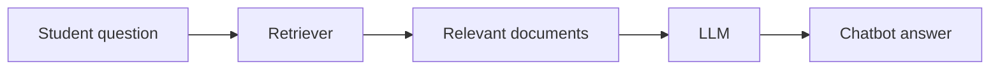
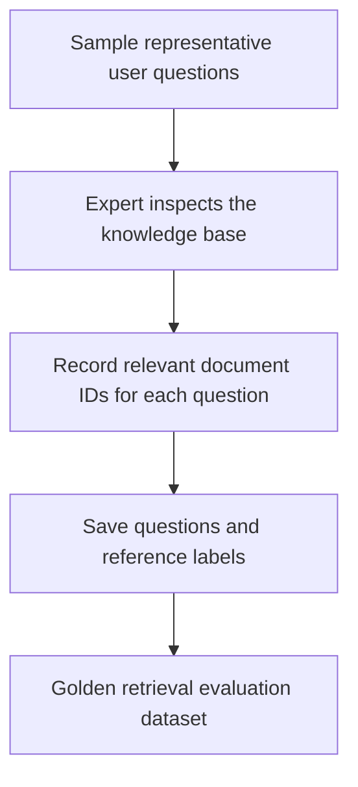
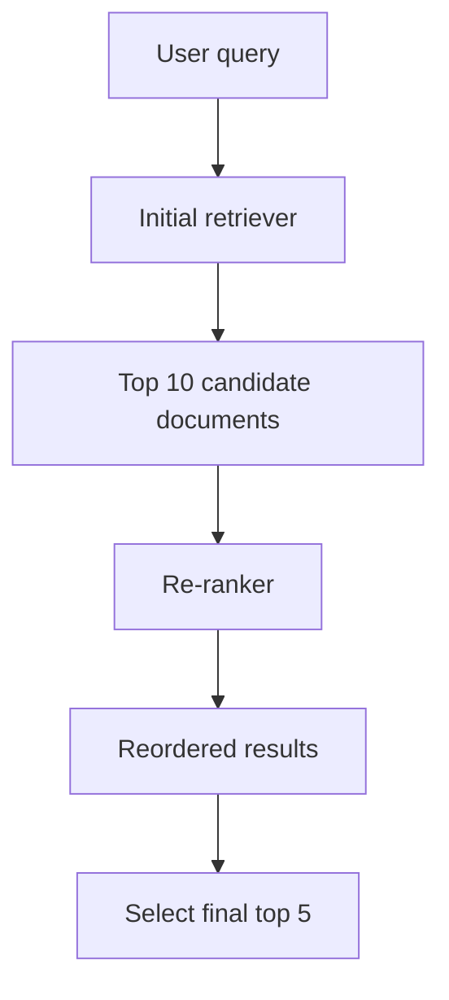
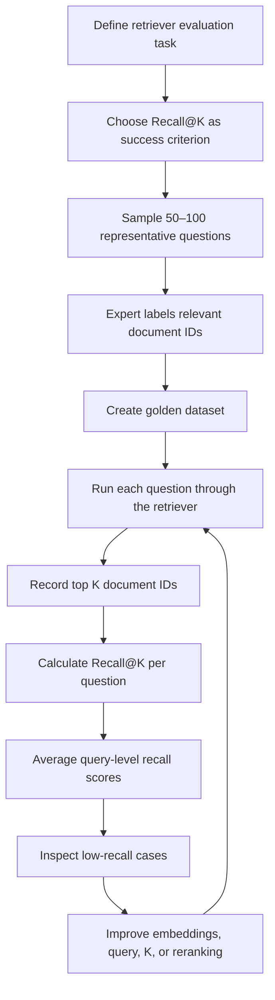

# 4.2. Programmatic / Deterministic Evaluation

## Learning Objectives

By the end of this section, you should be able to:

- Explain when programmatic evaluation is appropriate.
- Distinguish component-level evaluation from whole-application evaluation.
- Design a small retrieval evaluation dataset with known relevant documents.
- Calculate Recall@K for one query and average it across multiple queries.
- Interpret retrieval results and identify opportunities for improvement.

<br/>

## 1. What Is Programmatic / Deterministic Evaluation?

**Programmatic evaluation** uses code to assess a model or application against explicit rules, exact comparisons, or measurable metrics.

It works well when the success criterion can be expressed clearly enough for a program to calculate it consistently.

Examples include:

- Calculating classification accuracy from known labels.
- Checking whether required fields exist in a JSON response.
- Comparing generated output with an expected value.
- Measuring how effectively a retriever finds relevant documents.

The key distinction is that a program executes the evaluation. A human may still be needed to prepare the dataset or define the correct answers, but that does not make the evaluation execution human-based.

<br/>

## 2. Component-Level vs. Whole-Application Evaluation

Consider a RAG chatbot built for **Campus X**. Students may ask about course prerequisites, fees, course duration, certificates, and other campus information.

A RAG application typically retrieves relevant documents and then uses them as context to generate an answer.



There are different levels at which the application can be evaluated.

<br/>

### Component-level evaluation

Evaluate one component in isolation—for example, the retriever.

**Task:** Determine whether the retriever returns the relevant documents for a question.

**Target:** The retriever component, not the complete RAG chatbot.

**Success criterion:** Recall@K, which measures how many of the known relevant documents appear among the top K retrieved documents.

<br/>

### Whole-application evaluation

Evaluate the complete RAG chatbot, including retrieval and answer generation.

Possible criteria include whether the answer is accurate, complete, grounded in the retrieved context, and helpful. Such qualities may require a rubric or an LLM judge rather than only a simple retrieval metric.

**Important:** A retriever can perform well while the final answer is poor, and a fluent answer does not prove that retrieval worked correctly. Component-level and application-level evaluation answer different questions.

<br/>

## 3. Define the Evaluation Task Before Running It

A practical evaluation setup should specify four things.

1. **Task:** What do we want to test?
2. **Target:** Which component or system are we testing?
3. **Success criterion:** What measurable result indicates acceptable performance?
4. **Evaluation dataset:** Which test examples will we use?

For the Campus X retriever:

| Item | Definition |
|---|---|
| Task | Check whether relevant documents are retrieved |
| Target | Retriever component |
| Success criterion | Recall@5 |
| Dataset | Representative questions with known relevant document IDs |

Defining these items before running the evaluation makes the results easier to interpret.

<br/>

## 4. Build a Representative Golden Dataset

A retrieval evaluation needs questions and a reference identifying which documents are relevant to each question. This reference information is often called **ground truth** or part of a **golden dataset**.

The lesson proposes collecting approximately **50–100 questions** that resemble what future users may ask. The dataset should cover a range of cases, including:

- Easy questions.
- Difficult questions.
- Typical or common questions.
- Random or less common questions.
- Edge cases that may challenge the retriever.

A subject-matter expert examines each question and identifies the document or documents that contain the relevant answer. This reference annotation is created before scoring the retriever.

<br/>

### Example golden dataset

The following small dataset is illustrative and is designed to demonstrate the structure. It is not the original dataset shown in the lesson.

| Query ID | User question | Known relevant document IDs |
|---|---|---|
| Q1 | What are the prerequisites for the ML course? | 1001 |
| Q2 | What are the ML course prerequisites, and how long is it? | 1001, 1003 |
| Q3 | What is the fee for the deep learning course? | 1010 |
| Q4 | Is a certificate provided after course completion? | 1012, 1014 |
| Q5 | Can I pay the course fee in installments? | 1020 |

Document IDs are used to make the evaluation concrete. In a real dataset, the reference annotation should be checked carefully so that relevant documents are not accidentally omitted.

<br/>

### Dataset flow



The expert is helping create the reference dataset. The retriever evaluation itself can still be programmatic because code calculates the metric by comparing retrieved IDs with the reference IDs.

<br/>

## 5. Understand Recall@K

**Recall@K** measures the proportion of all known relevant documents that appear in the retriever's top K results.

$$
\operatorname{Recall@K}(q)=
\frac{\left|\text{Relevant}(q)\cap\text{RetrievedTopK}(q)\right|}
{\left|\text{Relevant}(q)\right|}
$$

Where:

- $\text{Relevant}(q)$ is the set of known relevant documents for query $q$.
- $\text{RetrievedTopK}(q)$ is the set of the first K documents returned by the retriever.
- The numerator counts relevant documents that were successfully retrieved.
- The denominator counts all known relevant documents for that query.

Recall@K ranges from 0 to 1, or 0% to 100%, provided at least one relevant document is defined for the query.

<br/>

### Worked example from the lesson

Question:

> What are the prerequisites for the ML course, and how long is it?

Suppose the expert has established that the answer is contained in two documents:

- Relevant documents: `{1001, 1003}`

The retriever is configured with $K=5$ and returns:

- Retrieved top five: `{1001, 1002, 1004, 1005, 1006}`

Only document `1001` is relevant and was retrieved. Document `1003` was missed.

$$
\operatorname{Recall@5}=\frac{1}{2}=0.5=50\%
$$

The retriever found half of the known relevant documents for this query.

```mermaid
flowchart TD
    A[Known relevant documents: 1001, 1003] --> C[Compare document IDs]
    B[Retrieved top 5: 1001, 1002, 1004, 1005, 1006] --> C
    C --> D[Relevant documents retrieved: 1]
    D --> E[Recall@5 = 1 / 2 = 50%]
```

**Interpretation:** Recall@5 does not ask whether all five returned documents are relevant. It asks how many of the known relevant documents were recovered within the top five.

<br/>

## 6. Calculate Recall@K Across a Dataset

Evaluating a retriever on one question is not enough to understand its overall behavior. Run every evaluation question through the retriever, calculate the recall for each query, and average the per-query scores.

### Illustrative retrieval results

The following is a small teaching dataset—not the original 50–100-question dataset from the lesson. For simplicity, \(K=5\) is used for every query.

| Query | Relevant documents | Retrieved top five | Relevant documents found | Recall@5 |
|---|---|---|---:|---:|
| Q1 | 1001 | 1001, 1002, 1004, 1005, 1006 | 1/1 | 100% |
| Q2 | 1001, 1003 | 1001, 1002, 1004, 1005, 1006 | 1/2 | 50% |
| Q3 | 1010 | 1008, 1009, 1010, 1011, 1012 | 1/1 | 100% |
| Q4 | 1012, 1014 | 1012, 1013, 1015, 1016, 1017 | 1/2 | 50% |
| Q5 | 1020 | 1002, 1004, 1010, 1011, 1013 | 0/1 | 0% |

Mean Recall@5 for this illustrative dataset:

$$
\frac{1.00+0.50+1.00+0.50+0.00}{5}=0.60=60\%
$$

This 60% is only the result of the five-row teaching dataset. In the lesson, the larger example uses approximately 50–100 questions and reports an overall Recall@K of **67%**.

<br/>

### Python implementation

```python
def recall_at_k(relevant_ids, retrieved_ids, k=5):
    """Calculate Recall@K for one query."""
    relevant = set(relevant_ids)
    retrieved_top_k = set(retrieved_ids[:k])

    if not relevant:
        raise ValueError("Each query must have at least one relevant document.")

    found = len(relevant & retrieved_top_k)
    return found / len(relevant)


def mean_recall_at_k(evaluation_cases, k=5):
    """Calculate mean Recall@K across evaluation queries."""
    if not evaluation_cases:
        raise ValueError("The evaluation dataset must not be empty.")

    scores = [
        recall_at_k(
            case["relevant_ids"],
            case["retrieved_ids"],
            k=k,
        )
        for case in evaluation_cases
    ]
    return sum(scores) / len(scores)


evaluation_cases = [
    {"query_id": "Q1", "relevant_ids": ["1001"],
     "retrieved_ids": ["1001", "1002", "1004", "1005", "1006"]},
    {"query_id": "Q2", "relevant_ids": ["1001", "1003"],
     "retrieved_ids": ["1001", "1002", "1004", "1005", "1006"]},
    {"query_id": "Q3", "relevant_ids": ["1010"],
     "retrieved_ids": ["1008", "1009", "1010", "1011", "1012"]},
    {"query_id": "Q4", "relevant_ids": ["1012", "1014"],
     "retrieved_ids": ["1012", "1013", "1015", "1016", "1017"]},
    {"query_id": "Q5", "relevant_ids": ["1020"],
     "retrieved_ids": ["1002", "1004", "1010", "1011", "1013"]},
]

for case in evaluation_cases:
    score = recall_at_k(
        case["relevant_ids"],
        case["retrieved_ids"],
        k=5,
    )
    print(f'{case["query_id"]}: Recall@5 = {score:.0%}')

overall = mean_recall_at_k(evaluation_cases, k=5)
print(f"Mean Recall@5 = {overall:.0%}")
```

Expected output:

```text
Q1: Recall@5 = 100%
Q2: Recall@5 = 50%
Q3: Recall@5 = 100%
Q4: Recall@5 = 50%
Q5: Recall@5 = 0%
Mean Recall@5 = 60%
```

This code demonstrates the metric calculation. In a real evaluation pipeline, the `retrieved_ids` would be produced by the retriever being tested.

<br/>

## 7. Recall, Precision, and Ranking Quality

The lesson focuses on Recall@K but also mentions precision and ranking as other retrieval-evaluation perspectives.

- **Recall@K:** Of all known relevant documents, what fraction appeared in the top K?
- **Precision@K:** Of the K retrieved documents, what fraction are relevant?
- **Ranking quality:** Are the most useful documents placed near the top of the results?

For Q2, the relevant set is `{1001, 1003}` and the retrieved top five contains only `1001`.

- Recall@5 = $1/2=50\%$.
- Precision@5 = $1/5=20\%$, because one of the five retrieved documents is relevant.

A retriever can have reasonable recall but low precision if it returns many irrelevant documents. Ranking metrics can provide additional insight into where relevant documents appear in the result list.

<br/>

## 8. Interpret Results and Investigate Failures

Suppose the larger evaluation dataset produces a mean Recall@5 of **67%**, as reported in the lesson.

This means the retriever is recovering, on average, about 67% of the known relevant documents within the top five results per query, using the mean-per-query calculation described above.

The next step is not simply to accept the score. Inspect questions with low recall and look for patterns:

- Are relevant documents consistently missing?
- Does the query use different terminology from the document?
- Is the embedding model capturing the semantic meaning of the query?
- Are relevant documents present farther down the result list?
- Are the reference annotations complete and correct?

The score identifies an area to investigate; it does not by itself identify the cause.

<br/>

## 9. Improve the Retriever

The lesson describes four practical ways to improve retrieval performance.

### 9.1 Use a Better Embedding Model

The embedding model converts queries and documents into vector representations. If it does not represent their semantic relationship well, relevant documents may not rank highly.

**Action:** Evaluate alternative embedding models on the same golden dataset and compare Recall@K.

<br/>

### 9.2 Apply Query Expansion

Instead of sending only the user's original question to the retriever, use an LLM or another method to expand the query with useful context, related terms, or alternate phrasing.

Example:

- Original query: “ML course prerequisites and duration?”
- Expanded query: “Eligibility requirements, prior knowledge, prerequisites, and total duration of the machine learning course.”

The expanded query may help retrieve documents that use different wording. However, expansion can also introduce irrelevant terms, so it should be evaluated rather than assumed to help.

<br/>

### 9.3 Increase K

If a relevant document appears at rank 8, a top-five retrieval will miss it, while a top-ten retrieval may include it.

**Action:** Compare Recall@5 and Recall@10 on the same dataset. A larger K can improve recall, but it may also introduce more irrelevant context and increase downstream processing costs.

<br/>

### 9.4 Add a Re-ranking Stage

A retriever may first fetch a larger candidate set and then use a re-ranker to reorder those candidates by relevance.



For example, a relevant document ranked eighth in the initial results might move to third after re-ranking. If it is then included in the final top five, it can contribute to Recall@5.

A re-ranker cannot recover a document that was never included in its candidate set. Therefore, candidate retrieval quality still matters.

<br/>

## 10. A Complete Programmatic Retrieval Evaluation Workflow



This workflow evaluates the **retriever component**, not the complete chatbot. The process is programmatic because code calculates the scores. Human expertise is used earlier to establish which documents are relevant.

<br/>

## 11. Key Takeaways

- Programmatic evaluation is appropriate when performance can be measured using explicit rules or metrics.
- Decide whether to evaluate an individual component or the entire application.
- A golden retrieval dataset contains representative questions and known relevant document IDs.
- Recall@K measures the fraction of known relevant documents found in the top K results.
- Calculate Recall@K per query and average the results to obtain a dataset-level score.
- Precision and ranking metrics complement recall by measuring different aspects of retrieval quality.
- Low scores should trigger error analysis, not just metric reporting.
- Embedding changes, query expansion, a larger K, and re-ranking are potential retrieval improvements that should be tested on the same evaluation dataset.

<br/>

## Practice Checkpoint

1. A query has four known relevant documents. The retriever finds three of them in its top five. What is Recall@5?
2. Why does the Campus X evaluation use known relevant document IDs?
3. What is the difference between evaluating a retriever and evaluating the entire RAG chatbot?
4. If Recall@5 is low but Recall@10 is much higher, what might that suggest?
5. Why should the same golden dataset be used when comparing two retriever configurations?

<br/>

### Answers

1. $3/4=75\%$.
2. The known IDs provide reference labels against which the retrieved results can be compared programmatically.
3. Retriever evaluation measures document retrieval; whole-application evaluation also considers the generated answer and other end-to-end quality criteria.
4. Some relevant documents may be retrieved, but ranked below position five.
5. Keeping the evaluation examples consistent makes the comparison more meaningful because differences are less likely to come from changing test questions.
