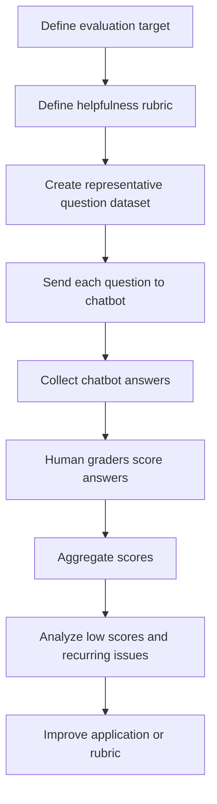
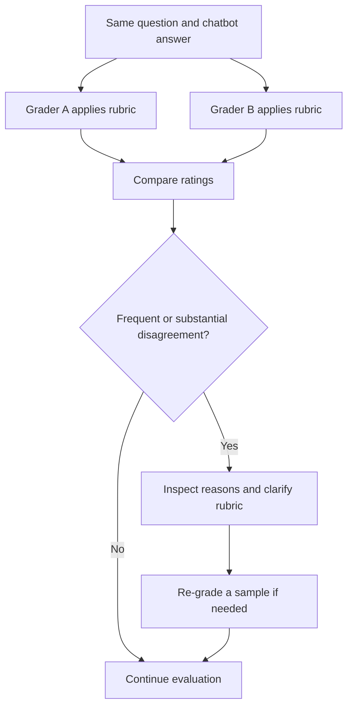
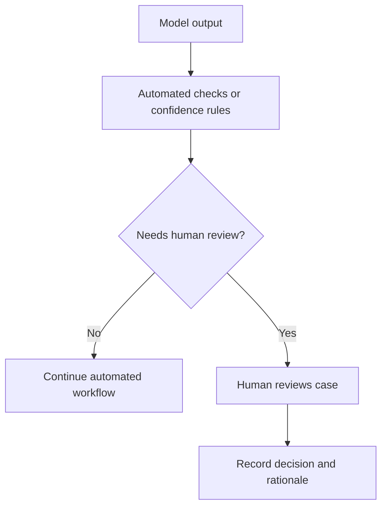

# Chapter 4.3 — Human-Based Evaluation

## Learning Objectives

By the end of this section, you should be able to:

- Explain when human judgment is appropriate for evaluating an LLM application.
- Define a task-specific rubric for evaluating chatbot helpfulness.
- Build a representative evaluation dataset and collect human ratings.
- Use multiple graders to identify ambiguity in evaluation criteria.
- Describe five common forms of human evaluation.
- Explain the quality-versus-cost trade-off of human-based evaluation.

 

## 1. What Is Human-Based Evaluation?

**Human-based evaluation** is an evaluation approach in which people judge model outputs or system behavior against defined criteria.

It is useful when the quality being evaluated is subjective, nuanced, or context-dependent. Examples include helpfulness, tone, completeness, and whether an answer adequately addresses a user's situation.

A program can calculate a metric when success is clearly defined. However, evaluating the helpfulness of an entire chatbot answer may require judgment that is difficult to express as a simple deterministic rule.

 

### Example: Campus X chatbot

Assume Campus X provides a document-grounded chatbot that answers questions about its courses, fees, certificates, refunds, and course validity.

The evaluation target is the **entire application**, not just one component such as the retriever. The goal is to evaluate the **helpfulness of its answers**.

In this example, helpfulness is defined through three dimensions:

1. **Accuracy** — Is the answer correct?
2. **Completeness** — Does it include the important information needed to answer the question?
3. **Appropriate tone** — Is the answer phrased suitably for the user and situation?

This is an application-quality evaluation. Safety and operational evaluation are outside the scope of this particular example.

 

## 2. Define a Rubric Before Grading

A **rubric** describes the criteria graders should use and how they should assign scores. It makes a subjective evaluation more structured and repeatable.

There is no universally correct helpfulness metric for every business. The rubric should reflect the application's purpose and user expectations.

### Example: 1–5 helpfulness scale

| Score | Interpretation | General guidance |
|---:|---|---|
| 5 | Very helpful | Accurate, complete, and appropriately phrased |
| 4 | Mostly helpful | Generally correct and useful, with a minor omission or issue |
| 3 | Partially helpful | Addresses part of the question but has a meaningful gap |
| 2 | Slightly helpful | Contains limited useful information but misses important needs |
| 1 | Unhelpful | Substantially incorrect, off-topic, or fails to answer the question |

The lesson explicitly defines the endpoints and midpoint: **5** means accurate, complete, and appropriately toned; **3** means partially helpful; and **1** means unhelpful or substantially off-topic. Scores 2 and 4 above are practical interpolations to make the example scale usable; a real evaluation team should define them explicitly.

 

### Rubric design principles

- Define each score with observable criteria.
- Separate accuracy, completeness, and tone in the grading instructions.
- Include examples of borderline answers when possible.
- Tell graders how to handle missing information, ambiguity, and unsupported claims.
- Avoid vague criteria such as “good answer” without explaining what “good” means.

 

## 3. Build a Representative Evaluation Dataset

Before grading, create a dataset of questions that represents what users may ask the chatbot.

The lesson describes a sample of roughly **50–100 questions**, including normal questions, difficult questions, edge cases, and other plausible user questions. Its example dataset contains a question column; the chatbot's answer is generated when each question is sent through the application.

Example questions include:

- How long is the ML course?
- Is the MML course right for me if I already know Python?
- What is the fee for the DL course?
- Do I get a refund if I drop out midway?
- Can I pay the course fee in installments?

A representative dataset should cover the expected range of user needs rather than only easy or frequently asked questions.

 

### Example dataset structure

| `question_id` | `question` | `chatbot_answer` | `grader_id` | `helpfulness_score` | `reason` |
|---|---|---|---|---:|---|
| Q001 | How long is the ML course? | Generated by chatbot | Grader A | 5 | Direct and complete answer |
| Q002 | Can I pay the course fee in installments? | Generated by chatbot | Grader A | 3 | Mentions payment options but does not clarify installment eligibility |
| Q003 | Do I get a refund if I drop out midway? | Generated by chatbot | Grader A | 1 | Gives no relevant refund information |

**Note:** These rows and scores are illustrative examples, not results reported in the lesson. Real answers and ratings must come from the application and graders.

The `reason` field is useful because it helps explain why a score was assigned and makes later analysis more actionable.

 

## 4. Human Evaluation Workflow

The basic workflow is:

 

### Step-by-step process

1. **Define the target:** Evaluate the helpfulness of the full Campus X chatbot.
2. **Define success criteria:** Specify accuracy, completeness, tone, and the 1–5 scale.
3. **Prepare test questions:** Include normal, difficult, and edge-case questions.
4. **Generate answers:** Run each question through the chatbot.
5. **Grade answers:** Ask a human grader to review each question and answer, then assign a score according to the rubric.
6. **Aggregate scores:** Calculate a summary score and inspect the score distribution.
7. **Investigate failures:** Review low-scoring answers and recurring error patterns.

 

### Aggregating scores

For $N$ evaluated answers, the mean helpfulness score is:

$$
\text{Mean Helpfulness} = \frac{1}{N}\sum_{i=1}^{N}s_i
$$

where $s_i$ is the human-assigned score for answer $i$.

For example, if five answers receive scores of $5, 4, 3, 3, 1$:

$$
\text{Mean Helpfulness} = \frac{5+4+3+3+1}{5}=3.2
$$

The result is an average score on the 1–5 scale, **not a percentage**. Report the distribution as well as the mean where possible; the same average can hide very different failure patterns.

 

## 5. Worked Example: Installment-Payment Question

**Question:** “Can I pay the course fee in installments?”

Suppose the chatbot answers:

> “Installment options may be available for some courses. Please check the course's payment details or contact the admissions team to confirm eligibility and the available schedule.”

This answer is used only as an illustrative example. Whether it is helpful depends on Campus X's actual policies and the rubric.

A grader could evaluate it as follows:

| Dimension | Grading question |
|---|---|
| Accuracy | Is the statement about installment availability consistent with the official policy? |
| Completeness | Does it explain whether installments are available and how to confirm eligibility? |
| Tone | Is the response clear, respectful, and appropriate? |

**Illustrative score: 3/5.** The answer gives a useful next step but does not directly confirm whether the user can pay in installments. If the official policy is known and the answer could have stated it, the omission may justify a lower score. If the policy genuinely varies by course, the answer may be more acceptable.

The score must follow the rubric and verified facts, not the grader's personal preference.

 

## 6. Why Use Multiple Graders?

A single grader can provide a rating, but multiple graders help reveal whether the rubric is clear enough to apply consistently.

Suppose Grader A assigns an answer a score of **2**, while Grader B assigns it **4**. If this pattern occurs repeatedly, the disagreement may indicate:

- The rubric does not define score boundaries clearly.
- Graders interpret “complete” or “helpful” differently.
- The instructions do not explain how to handle uncertain or partially correct answers.
- The answer has genuinely ambiguous qualities that require discussion.

 

### Multi-grader workflow

 

### What disagreement tells us

Disagreement does not automatically prove that one grader is wrong. It is a signal to investigate. The rubric may be ambiguous, the graders may need calibration, or the example may require context not included in the grading instructions.

A practical response is to compare the graders' explanations, revise unclear criteria, discuss example answers, and then re-grade a sample to check whether consistency improves.

 

### Useful agreement summaries

For numeric ratings, a team can begin with:

- **Exact agreement:** Percentage of items for which graders assign the same score.
- **Average absolute difference:** Average of the absolute differences between two graders' scores.
- **Per-score distribution:** How often each score is assigned by each grader.

For ordinal ratings, such as a 1–5 scale, a suitable chance-corrected statistic (for example, weighted Cohen's kappa for two graders) may also be useful. The right statistic depends on the number of graders and the evaluation design.

 

## 7. Five Human-Evaluation Activities

Human evaluation includes more than assigning a score to each answer. The lesson introduces five activities.

### 7.1 Direct grading and rating

Humans inspect a model output and assign a score using a rubric. For example, a grader rates the Campus X chatbot's answer about installment payments on the 1–5 helpfulness scale.

**Purpose:** Measure output quality against defined criteria.

 

### 7.2 Red teaming

Red teaming involves people deliberately probing an LLM-based system to discover where it fails. They may try unusual, adversarial, or challenging inputs and report weaknesses to the development team.

**Purpose:** Find vulnerabilities and failure modes that ordinary testing may miss.

Red teaming is a distinct evaluation activity from routine helpfulness scoring.

 

### 7.3 A/B testing with users

Two versions of an application are exposed to users under a defined experiment. User ratings or other selected outcomes are compared to understand which version performs better.

**Purpose:** Compare real-world user experience between alternatives.

A/B tests need a sound experimental design. A difference in ratings alone does not establish that a version is better if the groups, exposure, or measurement are not comparable.

 

### 7.4 Golden-dataset and rubric creation

Humans define expected answers, relevant documents, labels, or grading criteria. For example, a subject-matter expert may identify which document contains the answer to a query.

**Purpose:** Establish trusted evaluation data and criteria.

Creating a golden dataset is a human activity even when a program later executes the evaluation. The person who creates the dataset and the mechanism that executes the evaluation are separate parts of the process.

 

### 7.5 Human-in-the-loop review

A system routes difficult, uncertain, or high-impact cases to a human when automated checks are not sufficient or a defined threshold is crossed.

**Purpose:** Use human judgment selectively where it adds the most value.

The routing rule should be explicit—for example, a defined uncertainty threshold or a category of cases requiring manual approval.

 

## 8. Advantages and Limitations

| Aspect | Human-based evaluation |
|---|---|
| Main advantage | People can assess nuanced, context-dependent qualities that are difficult to reduce to simple rules. |
| Reliability | Expert human judgment can be valuable, but it is not automatically consistent; graders need clear criteria and calibration. |
| Main limitation | Cost: people must be recruited, trained, and paid for their time. |
| Scalability | Reviewing every output can become impractical when an application serves a very large number of users. |
| Best fit | Subjective quality assessment, rubric creation, adversarial testing, user experience comparisons, and uncertain cases needing judgment. |

 

### Quality versus cost

Human evaluation is often valuable for establishing trusted judgments and examining complex failures. However, using people to grade every output can be expensive and slow at scale.

A practical system can combine approaches:

- Use programmatic checks for properties with clear rules.
- Use human judgment for nuanced evaluation and reference-data creation.
- Route only selected uncertain or difficult cases to human reviewers.

The lesson's next topic considers the approach between programmatic checks and human judgment: model-graded evaluation.

 

## 9. Key Takeaways

- Human-based evaluation is appropriate when the target quality is subjective, nuanced, or context-dependent.
- Define the evaluation target and rubric before grading.
- A representative dataset should include normal, difficult, and edge-case questions.
- Human graders score answers against the rubric; aggregated scores summarize the results.
- Multiple graders help expose unclear criteria and inconsistent interpretations.
- Human evaluation includes direct grading, red teaming, A/B testing, golden-dataset/rubric creation, and human-in-the-loop review.
- Human judgment can be valuable, but its cost makes full-scale review difficult.
- Human-created evaluation data can be used by programmatic or model-based evaluators later.

 

## 10. Practice and Revision

1. Why is helpfulness difficult to measure using only deterministic programmatic rules?
2. Define accuracy, completeness, and appropriate tone for a Campus X chatbot.
3. What types of questions should a representative evaluation dataset include?
4. A grader gives an installment-payment answer a score of 3/5. What evidence should support that score?
5. What might repeated disagreement between two graders tell you about the rubric?
6. Explain the difference between direct grading, red teaming, A/B testing, golden-dataset creation, and human-in-the-loop review.
7. Why might a team avoid using humans to evaluate every output in a system serving millions of users?

 

### Checkpoint

**Scenario:** Two graders evaluate 40 chatbot answers. They frequently disagree, especially between scores 3 and 4.

**A good response should explain:** Review the reasons behind the disagreements, clarify the boundary between “partially helpful” and “mostly helpful,” add concrete examples to the rubric, calibrate graders, and re-evaluate a sample to determine whether agreement improves.
