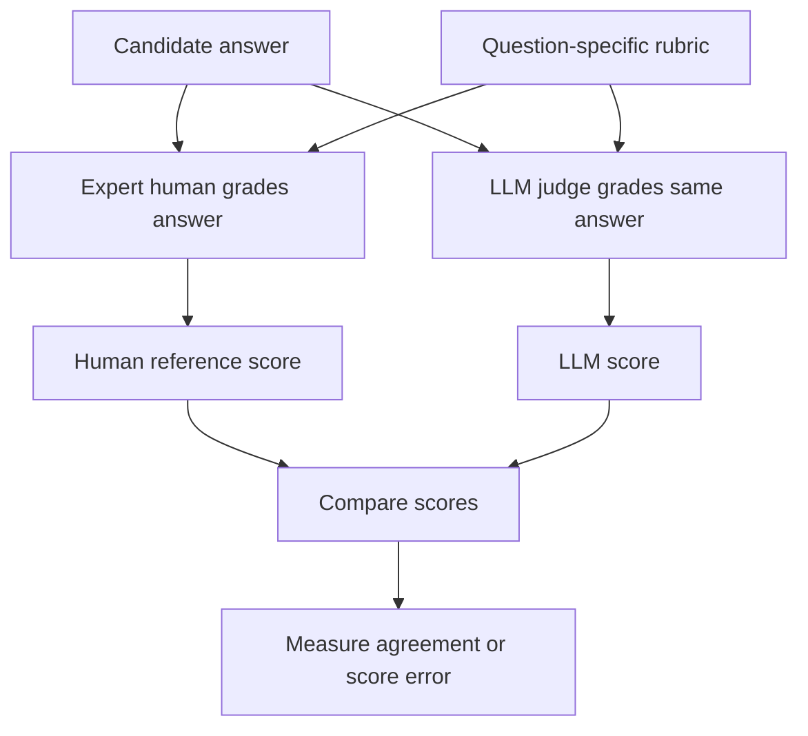

# Chapter 4.4 — Model-Graded Evaluation: LLM-as-a-Judge

## Learning Objectives

By the end of this section, you should be able to:

- Explain why LLM-as-a-Judge is useful for evaluating subjective outputs at scale.
- Define a task-specific rubric and build a small human-graded reference dataset.
- Design a prompt that instructs an evaluator LLM to score answers consistently.
- Compare LLM-assigned scores with expert human scores.
- Use evaluation errors to improve the rubric, judge prompt, or evaluator model.

<br/>

## 1. What Is Model-Graded Evaluation?

**Model-graded evaluation** uses an LLM to judge the quality of another model's output or an application's response according to explicit instructions and criteria.

The common pattern is called **LLM-as-a-Judge**: an LLM is given the task, the relevant criteria, the candidate response, and instructions for how to evaluate it.

It is useful when:

- Programmatic rules cannot capture the full quality being assessed.
- Human grading provides valuable judgment but is too expensive to perform for every output at scale.

The evaluator model does not automatically become a reliable judge just because it is an LLM. Its behavior must itself be evaluated against trusted human judgments.


<br/>


## 2. Worked Scenario: Grading UPSC Mains Answers

Imagine Campus X UPSC offers mock examinations. Preliminary exams are largely multiple-choice, whereas Mains includes subjective answers that require more nuanced evaluation.

If thousands of candidates submit answers, asking subject-matter experts to grade every answer can be expensive. The goal is to build a system that grades answers at scale while approximating how expert human graders would score them.

<br/>

### Define the evaluation target and success criterion

- **Target:** The automated answer-grading platform.
- **Task:** Evaluate whether it grades UPSC Mains-style answers similarly to a human subject expert.
- **Success criterion:** Its scores should be sufficiently similar to expert human scores on the same answers, using the same rubric.

The lesson treats similarity to human expert grading as the central success criterion. A specific metric is then used to quantify the difference between the two sets of scores.




<br/>


## 3. Create a Clear, Task-Specific Rubric

Before evaluating the judge, define what a good answer means for each question. A rubric should be designed with subject-matter expertise because different questions require different content and reasoning.

In the lesson's example, a UPSC Mains paper contains three questions:

1. “Ethical governance is impossible without administrative accountability. Discuss.” — 15 marks.
2. “Examine the role of the Governor in Centre–State relations.” — 10 marks.
3. “Federalism in India is more cooperative than competitive. Critically analyse.” — 15 marks.

These question examples and mark allocations are from the lesson's scenario.

<br/>

### Example rubric dimensions

For the first question, an expert might define dimensions such as:

- Addresses ethical governance and accountability.
- Explains the relationship between the two.
- Discusses relevant mechanisms.
- Provides suitable examples.
- Reaches a balanced conclusion.

A rubric is not the dataset itself. It is the set of criteria used to assess answers to a question.

<br/>

### Why question-specific rubrics matter

A generic instruction such as “Give this answer a good score” leaves too much room for inconsistent interpretation. A question-specific rubric identifies the important dimensions and connects them to the expected mark allocation.

A usable rubric should clarify:

- What each dimension means.
- What evidence counts as addressing it.
- How partial coverage is scored.
- How the dimension-level scores add up to the question's total marks.

The lesson uses the dimensions above as an example; it does not establish them as a universal rubric for all UPSC questions.


<br/>


## 4. Build the Evaluation Dataset

The lesson proposes first asking a subject-matter expert to grade approximately **50–100 answers** using the defined rubric. This creates a small **golden dataset** of human reference judgments.

Each record should connect the question, rubric, candidate answer, and expert score.

### Suggested dataset schema

| Field | Purpose |
|---|---|
| `answer_id` | Unique identifier for the answer |
| `question` | Original exam question |
| `max_marks` | Maximum marks for that question |
| `rubric` | Question-specific grading criteria |
| `candidate_answer` | Exact answer written by the candidate |
| `human_score` | Expert's score for the answer |
| `human_notes` | Optional explanation supporting the score |

Example record (illustrative structure, not an actual student submission):

| Field | Example |
|---|---|
| `answer_id` | A001 |
| `question` | Ethical governance is impossible without administrative accountability. Discuss. |
| `max_marks` | 15 |
| `rubric` | Relationship, mechanisms, examples, balanced conclusion |
| `candidate_answer` | The candidate's original written response |
| `human_score` | 13 |
| `human_notes` | Covers most dimensions with a minor gap |

The human score acts as the **reference score** against which the LLM judge's score will be compared. Preserve the original candidate answer rather than replacing it with a summary, because the judge must evaluate the answer that the candidate actually submitted.


<br/>


## 5. Prompt the LLM Judge

For every candidate answer, provide the evaluator model with the information required to make a grounded judgment:

1. **Role and objective:** Explain that it is grading a UPSC Mains answer.
2. **Original question:** Include the exact question.
3. **Maximum marks:** State the mark allocation.
4. **Question-specific rubric:** Supply the criteria for this question.
5. **Candidate answer:** Include the exact answer to evaluate.
6. **Scoring instructions:** Ask the judge to assess each rubric dimension and assign marks.
7. **Anti-gaming instructions:** Do not reward verbosity, keyword stuffing, or confident claims that lack supporting substance.
8. **Concise justification:** Require a short explanation for the assigned score.

<br/>

### Example judge prompt

```text
Role:
You are an evaluator of UPSC Mains-style subjective answers.

Objective:
Grade the candidate answer against the question-specific rubric.
Assess the substance of the answer, not its length or confident tone.

Question:
{question}

Maximum marks:
{max_marks}

Rubric:
{rubric}

Candidate answer:
{candidate_answer}

Instructions:
1. Evaluate each rubric dimension independently.
2. Award credit only when the answer genuinely addresses the dimension.
3. Do not reward verbosity, keyword stuffing, or unsupported confident claims.
4. Consider relevant examples and balanced reasoning where the rubric requires them.
5. Assign a score within the allowed range from 0 to {max_marks}.
6. Give a concise justification tied to the rubric.
7. Do not invent facts or give credit for content that is not present.

Return:
- Dimension-level assessment
- Final score
- Concise justification
```

This is a template. The rubric, mark allocation, output schema, and grading rules should be adapted to the actual examination and tested on examples.

<br/>

### Example output format

```json
{
  "dimension_scores": [
    {
      "dimension": "Explains the relationship between ethical governance and accountability",
      "assessment": "Addresses the relationship but gives limited explanation",
      "score": 2
    }
  ],
  "total_score": 13,
  "justification": "The answer covers most rubric dimensions but develops one relationship only briefly."
}
```

The JSON is an illustrative output shape, not a score produced by an actual evaluator. In a real implementation, enforce a valid schema and check that dimension scores are within bounds and sum correctly to the total.


<br/>


## 6. Compare LLM Scores with Human Scores

Run the judge on the same answers that the expert graded. Each answer now has two scores:

- `human_score`: the expert's reference score.
- `llm_score`: the evaluator model's score.

The goal is not merely to obtain plausible-looking LLM feedback. The goal is to determine whether the judge's scores track expert judgments on examples it did not use to tune the prompt, where feasible.

<br/>

### Example comparison table

| Answer ID | Human score | LLM score | Absolute error |
|---|---:|---:|---:|
| A001 | 13 | 12 | 1 |
| A002 | 4 | 6 | 2 |
| A003 | 10 | 10 | 0 |
| A004 | 7 | 8 | 1 |

**Note:** These scores are illustrative and are not results reported in the lesson.

<br/>

### Mean Absolute Error (MAE)

For numeric scores, a straightforward comparison metric is **Mean Absolute Error (MAE)**:

$$
\operatorname{MAE}=\frac{1}{N}\sum_{i=1}^{N}|h_i-\ell_i|
$$

where:

- $N$ is the number of evaluated answers.
- $h_i$ is the human score for answer $i$.
- $\ell_i$ is the LLM judge's score for the same answer.

Using the illustrative table above:

$$
\operatorname{MAE}=\frac{|13-12|+|4-6|+|10-10|+|7-8|}{4}
=\frac{1+2+0+1}{4}=1
$$

The MAE is **1 mark** on the scoring scales used in this example. Lower MAE indicates that the LLM scores are, on average, closer to the human reference scores. The acceptable error depends on the exam's scoring range and how consequential grading decisions are.

MAE does not tell the entire story. Also inspect large disagreements, systematic over-scoring or under-scoring, performance by question type, and whether the judge treats different groups of answers consistently.


<br/>


## 7. Improve the Judge Iteratively

If the LLM scores differ substantially from expert scores, analyze the disagreements rather than simply trusting the automated scores.

A practical iteration loop is:

```mermaid
flowchart TD
    A[Create rubric and human-graded dataset] --> B[Run LLM judge]
    B --> C[Compare LLM scores with human scores]
    C --> D[Inspect large errors and recurring patterns]
    D --> E[Revise prompt or rubric]
    E --> F{Still inconsistent?}
    F -- Yes --> G[Test a different evaluator model}
    G --> B
    F -- No --> H[Validate on held-out examples]
    H --> I[Monitor judge performance over time]
```

Potential improvements include:

- **Prompt revision:** Clarify ambiguous instructions and score boundaries.
- **Rubric revision:** Define what full, partial, and no credit mean for each dimension.
- **Evaluator-model selection:** Test another model if the current judge misses important content or applies the rubric poorly.
- **Structured output validation:** Check score ranges, required fields, and arithmetic consistency.
- **Held-out validation:** Keep some human-graded examples separate from prompt development to test generalization.
- **Error analysis:** Inspect cases where the judge over-scores, under-scores, or overlooks a rubric dimension.

Avoid repeatedly tuning the prompt against the same small set and then treating performance on that set as proof of general reliability. Validate the final judge on new examples.


<br/>


## 8. Important Limitations

LLM-as-a-Judge reduces the need for human grading at runtime, but it does not eliminate the need for human expertise.

- The judge can misinterpret a rubric or overlook relevant content.
- It may be sensitive to prompt wording or answer presentation.
- It can reward length, keywords, or confident language unless explicitly instructed and tested not to.
- The human reference scores may themselves contain disagreement or error.
- A low average MAE can hide serious errors on particular question types or individual answers.
- High agreement with a reference set does not prove that the rubric measures every quality that matters.

For consequential decisions, use expert review, validation on representative examples, and a process for escalating uncertain or disputed cases.


<br/>


## 9. Key Takeaways

- LLM-as-a-Judge uses an evaluator model to score outputs against explicit criteria.
- It is a useful middle ground when programmatic rules are too limited and human grading at full scale is too expensive.
- Define the success criterion first: the judge should approximate expert human judgments on the same answers.
- Create a question-specific rubric before building and running the judge.
- A small golden dataset of around 50–100 expert-graded answers can provide a starting point for evaluation.
- Prompt the judge with the question, mark allocation, rubric, exact candidate answer, scoring rules, anti-gaming instructions, and a concise justification requirement.
- Compare human and LLM scores using MAE and error analysis.
- Improve the prompt, rubric, or evaluator model iteratively, then validate on held-out answers.


<br/>


## 10. Practice and Revision

1. Why might an LLM judge be more practical than human grading for thousands of subjective answers?
2. What is the difference between a rubric and a golden dataset?
3. Why should the judge receive the exact question and maximum mark allocation?
4. Why should the prompt explicitly reject verbosity, keyword stuffing, and unsupported claims as reasons for awarding marks?
5. If human scores are \([8, 10, 4]\) and LLM scores are \([7, 8, 5]\), calculate MAE.
6. What can a low MAE hide?
7. Why should a final judge be validated on answers not used to tune its prompt?

<br/>

### Checkpoint

**Scenario:** An LLM judge gives consistently higher scores than a subject expert, especially to long answers with many relevant-looking keywords.

**A good response should explain:** Inspect the over-scored examples, revise the rubric and prompt to require genuine evidence for each dimension, prohibit credit for verbosity or keyword stuffing, and validate the revised judge on held-out human-graded answers.
