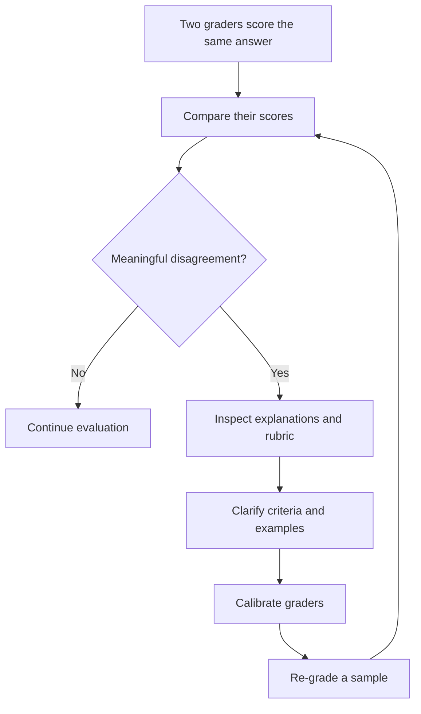
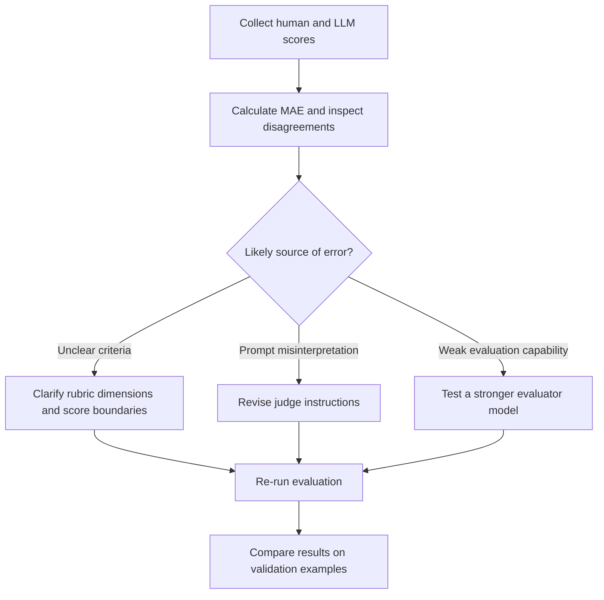

# Chapter 4.5 — Evaluator Agreement, Consistency, and Variance

## Learning Objectives

By the end of this section, you should be able to:

- Explain why evaluator consistency matters.
- Interpret disagreement between human graders.
- Compare LLM-judge scores with human reference scores.
- Calculate and interpret Mean Absolute Error (MAE).
- Investigate large score differences and improve evaluation consistency.

 

## 1. Why Evaluator Reliability Matters

An evaluation score is useful only when the evaluation process is sufficiently consistent for the intended purpose. If the same answer receives very different scores from different graders, it becomes difficult to determine whether a model has improved or whether the difference comes from the evaluation process.

Evaluator reliability is especially important when scores are used to compare model versions, select a system for deployment, or identify regressions.

**Consistency does not automatically mean correctness.** Evaluators can agree and still apply a flawed rubric. Reliability should therefore be considered alongside the quality of the rubric and the validity of the evaluation task.

 

## 2. Human–Human Disagreement

In human-based evaluation, two graders may assign different scores to the same answer. For example, one grader might give an answer **2/5**, while another gives it **4/5**.

Repeated disagreements can reveal:

- **Rubric ambiguity:** Score descriptions may not clearly distinguish partially helpful from mostly helpful answers.
- **Different interpretations:** Graders may apply terms such as “complete,” “accurate,” or “well-supported” differently.
- **Insufficient instructions:** The rubric may not explain how to score partially correct, uncertain, or borderline cases.
- **A need for calibration:** Graders may need to review example answers and discuss how the criteria should be applied.

 

### How to investigate disagreement

1. Compare the ratings for the same answers.
2. Review the reasons each grader gave.
3. Identify the rubric dimension responsible for the difference.
4. Clarify score boundaries and add concrete examples.
5. Calibrate graders using the revised rubric.
6. Re-grade a sample to see whether agreement improves.

Disagreement is a diagnostic signal, not automatic proof that either grader is wrong.

 

## 3. Human–LLM Score Comparison

For an LLM-as-a-Judge system, compare the model's scores with expert human scores on the **same examples**.

- **Human score:** The reference judgment assigned by a human expert using the rubric.
- **LLM score:** The score assigned by the evaluator model using that rubric.
- **Score difference:** The numerical gap between the two scores for an answer.

The aim is to determine whether the LLM judge approximates expert judgments closely enough for the intended use.

A human score is a **reference judgment**, not proof of objective perfection. Human graders can disagree, overlook evidence, or apply a rubric inconsistently. Where possible, use clear criteria and resolve or document significant human disagreement before treating scores as trusted references.

 

### Example comparison table

| Answer | Human score | LLM score | Absolute difference |
|---|---:|---:|---:|
| A001 | 13 | 12 | 1 |
| A002 | 4 | 6 | 2 |
| A003 | 10 | 10 | 0 |
| A004 | 7 | 8 | 1 |

These numbers are illustrative examples, not measured results from an actual evaluation.

The absolute difference for an answer is:

$$
d_i = |h_i-\ell_i|
$$

where $h_i$ is the human score and $\ell_i$ is the LLM score for answer $i$.

Taking the absolute value ensures that both over-scoring and under-scoring count as disagreement.

 

## 4. Mean Absolute Error (MAE)

**Mean Absolute Error (MAE)** measures the average absolute difference between two sets of numerical scores.

$$
\operatorname{MAE}=\frac{1}{N}\sum_{i=1}^{N}|h_i-\ell_i|
$$

Where:

- $N$ is the number of evaluated examples.
- $h_i$ is the human reference score for example $i$.
- $\ell_i$ is the LLM judge's score for the same example.

 

### Calculation steps

1. Calculate the difference between the human and LLM scores for each answer.
2. Take the absolute value of each difference.
3. Add the absolute differences.
4. Divide the total by the number of answers.

 

### Worked example

Suppose four answers have the following scores:

| Answer | Human score | LLM score | Absolute difference |
|---|---:|---:|---:|
| A001 | 13 | 12 | $|13-12|=1$ |
| A002 | 4 | 6 | $|4-6|=2$ |
| A003 | 10 | 10 | $|10-10|=0$ |
| A004 | 7 | 8 | $|7-8|=1$ |
| **Total** |  |  | **4** |

$$
\operatorname{MAE}=\frac{1+2+0+1}{4}=1
$$

The MAE is **1 mark**. On these examples, the LLM's score differs from the human score by one mark on average.

 

### Interpreting MAE

- **MAE = 0:** The human and LLM scores match exactly on all evaluated examples.
- **Lower MAE:** The LLM scores are closer to the human scores on average.
- **Higher MAE:** The LLM scores differ more from the human scores on average.

MAE is measured in the same units as the scores. For example, when grading out of 15 marks, an MAE of 2.3 means an average absolute difference of **2.3 marks**—not a 2.3% error.

An acceptable MAE depends on the score range and the consequences of an incorrect grade. A value that is tolerable for low-stakes practice feedback may be unacceptable for a high-stakes assessment.

 

## 5. Interpret the Score Gap and Inspect Large Errors

An average metric summarizes the dataset but does not explain why the judge disagrees with the reference scores.

Suppose the average absolute difference is **2.3 marks**. This means that, across the evaluated examples, the LLM's scores differ from the human scores by 2.3 marks on average. The next step is to investigate the cases contributing most to that error.

Questions to ask:

- Does the judge consistently award too many or too few marks?
- Does it miss one particular rubric dimension?
- Does it reward length or relevant-looking keywords without sufficient substance?
- Are disagreements concentrated in certain question types?
- Is the rubric itself ambiguous or difficult to apply?
- Are the human reference scores consistent and well-supported?

 

### MAE alone is not enough

MAE treats an over-score and an under-score of the same size equally. It also hides the direction of errors and can conceal a small number of severe disagreements.

Useful complementary checks include:

- **Signed error:**$(e_i=\ell_i-h_i$, which shows over-scoring when positive and under-scoring when negative.
- **Error distribution:** Inspect the median, range, and largest absolute errors.
- **Per-dimension analysis:** Compare the judge's assessment of each rubric dimension with the human review.
- **Question-level analysis:** Check whether performance varies by question type or mark allocation.

These checks help explain the metric rather than relying on a single average.

 

## 6. Improve Evaluator Agreement

When the judge disagrees with human experts, use the error patterns to decide what to change.

 

### Improvement strategies

1. **Clarify rubric dimensions.** Explain what full, partial, and no credit mean for each criterion.
2. **Revise the judge prompt.** Make scoring instructions more explicit and tell the judge to assess evidence rather than length, keywords, or confidence.
3. **Use a stronger evaluator model.** If the current judge repeatedly misses nuance, test another model and compare its scores against the same reference set.
4. **Improve grader calibration.** If humans disagree with one another, resolve unclear criteria before assuming the LLM is the only source of error.
5. **Validate after each change.** Re-run the evaluation on comparable examples and, where possible, use held-out examples not used to tune the judge.

Do not assume that a prompt or model change improves reliability merely because it lowers error on the same small set used during tuning. Confirm that the improvement generalizes to new examples.

 

## 7. Important Distinctions

| Concept | What it tells you | What it does not prove |
|---|---|---|
| Human–human agreement | How consistently graders apply the criteria | That the rubric is objectively correct |
| Human–LLM MAE | How close LLM scores are to human scores on average | That every LLM score is correct |
| Low MAE | Small average absolute score differences | That there are no serious outlier errors |
| Human reference score | The benchmark judgment used for comparison | That the judgment is infallible |

The quality of the evaluation depends on both the evaluator and the criteria used to judge the output.

 

## 8. Key Takeaways

- Evaluation scores are useful only when the process is sufficiently consistent for the task.
- Repeated human–human disagreement can reveal ambiguity in the rubric or a need for grader calibration.
- Compare human and LLM scores on the same examples.
- MAE is the average absolute difference between paired numerical scores.
- MAE of zero means exact score agreement on the evaluated examples; lower MAE means closer agreement on average.
- An MAE of 2.3 marks means an average absolute difference of 2.3 marks, not 2.3%.
- Investigate large disagreements and systematic over-scoring or under-scoring.
- Improve agreement by clarifying the rubric, revising the judge prompt, or testing a stronger evaluator model.
- Treat human scores as reference judgments, not unquestionable ground truth.

 

## 9. Practice and Revision

1. Why does evaluator consistency matter when comparing two model versions?
2. What might repeated disagreement between human graders reveal?
3. Calculate MAE when human scores are \([8, 10, 4]\) and LLM scores are \([7, 8, 5]\).
4. What does an MAE of 2.3 marks mean when answers are graded out of 15?
5. Why can MAE hide important evaluator failures?
6. How would you investigate a judge that consistently over-scores long answers?
7. Why should the human reference score not be treated as proof of objective perfection?

 

### Checkpoint

**Scenario:** An LLM judge has an MAE of 2.3 marks against expert scores on a 15-mark question.

**A good response should explain:** The judge differs from expert scores by 2.3 marks on average. Inspect the largest disagreements, determine whether errors come from rubric ambiguity or judge behavior, revise the rubric or prompt (or test another evaluator model), and validate the changes on new examples.
