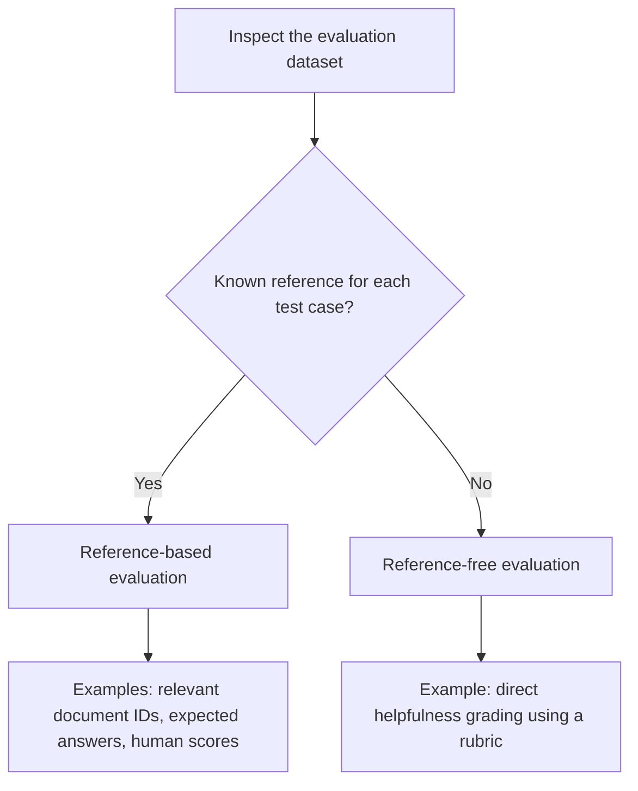
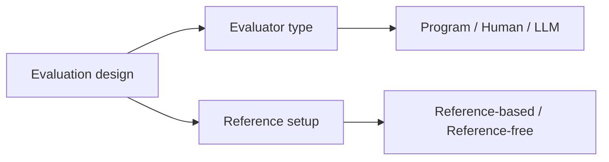

# Chapter 4.6 — Reference-Based and Reference-Free Evaluation

## Learning Objectives

By the end of this section, you should be able to:

- Distinguish reference-based evaluation from reference-free evaluation.
- Identify whether an evaluation dataset contains a known reference for each test case.
- Classify examples involving retriever Recall@K, human chatbot grading, and LLM-as-a-Judge.
- Explain why evaluator type and reference setup are separate dimensions.

 

## 1. Reference-Based Evaluation

**Reference-based evaluation** uses a known target or reference for each test case. Depending on the task, that reference may be:

- An expected answer.
- A set of relevant documents.
- A human-assigned score.
- Another predefined target against which the output can be compared.

The reference allows the evaluation process to assess an output relative to something already specified for that test case.

 

### Example: Retriever Recall@K

Suppose a query has two known relevant documents: document IDs `1001` and `1003`. The retriever returns its top five documents:

`{1001, 1002, 1004, 1005, 1006}`

Only one of the two known relevant documents was retrieved. Therefore:

$$
\operatorname{Recall@K} =
\frac{\text{Relevant documents retrieved in top K}}
{\text{Total known relevant documents}}
=\frac{1}{2}=0.5
$$

The Recall@K score is **50%**. This is reference-based evaluation because the dataset supplies the known relevant-document IDs for the query.

 

### Example: UPSC LLM judge versus human scores

A subject-matter expert grades a set of UPSC Mains answers using a rubric. An LLM judge then grades the same answers, and its scores are compared with the expert's scores.

The human-assigned score for each answer is the reference. This is reference-based evaluation.

 

## 2. Reference-Free Evaluation

**Reference-free evaluation** does not supply a predefined correct answer or per-example reference score for each test case. Instead, the output is judged directly against stated criteria or a rubric.

Reference-free does **not** mean that the evaluation has no criteria. The evaluator still needs instructions about what to assess; what is missing is a known target or reference judgment for each individual test case.

 

### Example: Campus X chatbot helpfulness

Suppose the evaluation dataset contains only questions that users might ask the Campus X chatbot. The chatbot generates an answer to each question, and a human grader scores the answer's helpfulness using a general rubric that considers accuracy, completeness, and tone.

If the dataset does not contain a known correct answer or a human-assigned reference score for each question, this setup is reference-free. The human grader judges each generated answer directly against the rubric.

If the dataset instead included a trusted reference answer or a predefined reference score for every test case, the setup would be reference-based under the definitions used here.

 

## 3. How to Classify an Evaluation

To classify an evaluation, inspect the dataset and ask:

**Does each test case have a known reference target or reference judgment that the output is evaluated against?**

 

### Classification examples

| Evaluation setup | Reference available for each test case? | Classification |
|---|---|---|
| Retriever Recall@K with known relevant document IDs | Yes — relevant-document set | Reference-based |
| UPSC LLM judge compared with human-assigned scores | Yes — human score | Reference-based |
| Chatbot helpfulness graded by a human, where the dataset contains only questions and no per-question reference answer or score | No | Reference-free |

The classification depends on the reference information available in the evaluation setup—not merely on whether a human is involved.

 

## 4. Evaluator Type and Reference Setup Are Separate Dimensions

An evaluation has at least two distinct design choices:

1. **Who or what performs the evaluation?** A program, a human, or an LLM.
2. **What reference information is available?** A known target/reference or no per-example reference.

These dimensions answer different questions. “Human-based” describes the evaluator; “reference-free” describes the reference setup. They are not interchangeable labels.

| Evaluator | Possible reference setup | Example |
|---|---|---|
| Program | Reference-based | Calculate Recall@K using known relevant document IDs |
| Human | Reference-based | Compare a judgment with a known human reference score or expected target |
| Human | Reference-free | Directly score chatbot helpfulness using a rubric when no per-example reference is supplied |
| LLM | Reference-based | Compare an LLM judge's scores with human-assigned scores |
| LLM | Reference-free | Ask an LLM judge to assess an answer against a rubric without supplying a reference answer or score |

These combinations are conceptual examples. The exact classification depends on the information actually supplied to the evaluation.

 

## 5. Common Misunderstandings

- **“A human grader means the evaluation is reference-based.”** Not necessarily. A human can directly judge an output against a rubric without a predefined per-example reference.
- **“An LLM judge means the evaluation is reference-free.”** Not necessarily. The LLM's score can be compared with a known human reference score.
- **“Reference-free means there is no rubric.”** Incorrect. A rubric or evaluation criteria can still guide the judgment.
- **“A golden dataset always means the evaluator is programmatic.”** No. A human or LLM can evaluate examples from a dataset containing known references; the evaluator and reference setup are separate choices.

 

## 6. Key Takeaways

- Reference-based evaluation has a known target, expected answer, relevant-document set, or human-assigned score for each test case.
- Reference-free evaluation lacks a predefined correct answer or per-example reference score; outputs are judged directly against criteria or a rubric.
- Classify the setup by checking whether a known reference exists for each test case.
- Retriever Recall@K with known relevant-document IDs is reference-based.
- UPSC LLM scores compared with human-assigned scores are reference-based.
- Human grading of chatbot helpfulness from a question-only dataset, without per-example reference answers or scores, is reference-free.
- Evaluator type and reference setup are independent dimensions.

 

## 7. Practice and Revision

1. A retriever is evaluated against known relevant document IDs. Is this reference-based or reference-free? Why?
2. An LLM judge scores answers and its scores are compared with expert scores. How should this evaluation be classified?
3. A human grader scores chatbot answers using a rubric, but the dataset contains only questions and no reference answers or scores. How should it be classified?
4. Does reference-free evaluation mean that no rubric is used?
5. Explain why “human-based” and “reference-based” do not mean the same thing.

 

### Checkpoint

**Scenario:** An evaluation team uses an LLM to score chatbot responses against a rubric. It has no expected answer or reference score for each response.

**A good response should explain:** The evaluator type is LLM-based, while the reference setup is reference-free. These labels describe separate dimensions of the evaluation design.
