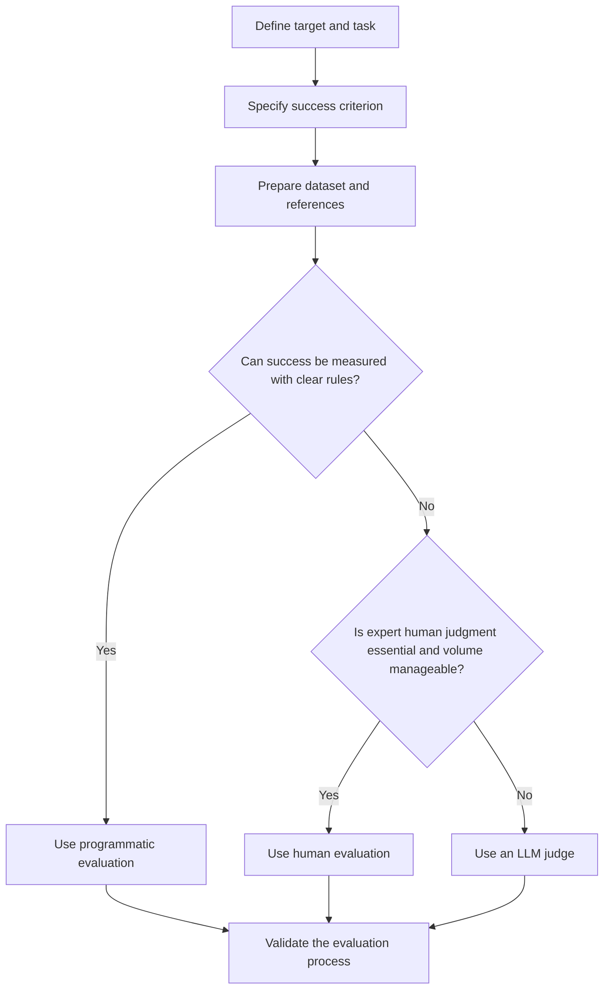
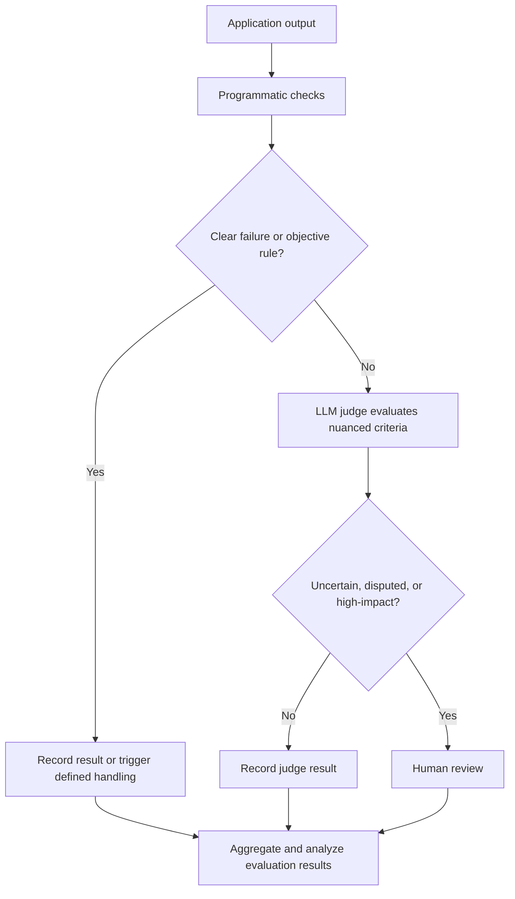

# Chapter 4.7 — Choosing an Evaluation Method for a Task

## Learning Objectives

By the end of this section, you should be able to:

- Select an evaluation method that matches the task and its success criterion.
- Identify the target, metric or rubric, and dataset requirements.
- Compare programmatic evaluation, human evaluation, and LLM-as-a-Judge.
- Consider cost, scale, complexity, rubric clarity, and the consequences of evaluation errors.
- Design a hybrid evaluation workflow when no single method is sufficient.

 

## 1. Start with the Task and Success Criterion

Choose an evaluation method only after defining what is being evaluated and what success means.

For any evaluation task, identify:

1. **Target:** What component or application are you evaluating?
2. **Task:** What quality or behavior do you want to measure?
3. **Success criterion:** What would a successful result look like?
4. **Dataset and references:** What examples are needed, and is a known target or reference judgment available?
5. **Evaluation method:** Who or what will assess the outputs?
6. **Validation:** How will you check that the evaluator itself is reliable enough?

The method should follow the nature of the task—not the other way around.

This is a practical starting point rather than a rigid rule. Some tasks need more than one method.

 

## 2. When to Use Each Evaluation Method

### 2.1 Programmatic evaluation

Use programmatic evaluation when the target can be measured with clear rules, known references, or objective metrics.

**Good fit when:**
- Expected labels or targets are available.
- Success can be expressed as a deterministic check or calculation.
- The evaluation must run frequently and cheaply.
- The result is easy to verify automatically.

**Examples:**
- Email classification: accuracy or other suitable classification metrics.
- RAG retrieval: Recall@K against known relevant-document IDs.
- Output-format checks: verify that required fields exist or that a response conforms to a schema.

**Main trade-off:** Programmatic checks are efficient and repeatable, but they only measure the properties encoded in the rules and metrics.

 

### 2.2 Human evaluation

Use human evaluation when nuanced expert judgment is essential and the volume of evaluation is manageable.

**Good fit when:**
- Quality depends on context, subtle reasoning, or domain expertise.
- A trusted rubric can be applied by trained graders.
- The consequences of an incorrect judgment justify human review.

**Examples:**
- Rating chatbot helpfulness against a rubric.
- Creating or reviewing a golden dataset.
- Evaluating complex or disputed outputs.

**Main trade-off:** Human judgment can capture nuance, but grading is costly and may vary between graders. Use clear rubrics and examine disagreement.

 

### 2.3 LLM-as-a-Judge

Use an LLM judge when the quality being assessed is subjective or complex and evaluation must scale beyond what is practical for human grading alone.

**Good fit when:**
- Simple programmatic rules do not adequately capture quality.
- The evaluation volume is large.
- The task can be described through explicit criteria or a rubric.
- Human-graded examples are available to validate the judge.

**Examples:**
- Grading subjective answers against a question-specific rubric.
- Assessing answer helpfulness or completeness.
- Applying consistent evaluation instructions across many generated responses.

**Main trade-off:** LLM judges can scale evaluation, but their scores may diverge from expert judgments. Validate the judge against human reference scores and inspect disagreements.

 

## 3. Match the Metric or Rubric to the Task

The metric should measure the property that matters for the application. A convenient metric is not necessarily a valid success criterion.

| Task | Suitable evaluation approach | Example metric or rubric |
|---|---|---|
| Classification | Programmatic comparison with known labels | Accuracy or another suitable classification metric, depending on class balance and error costs |
| Retrieval | Programmatic comparison with known relevant documents | Recall@K; precision and ranking measures provide additional perspectives |
| Chatbot helpfulness | Human or validated LLM-judge scoring | Task-specific rubric covering accuracy, completeness, and appropriate tone |
| Subjective answer grading | Human reference scores compared with LLM scores | MAE and analysis of score disagreements |

 

### Important metric-selection notes

- **Classification:** Accuracy can be misleading with imbalanced classes. Select metrics based on the task, class distribution, and relative cost of false positives and false negatives.
- **Retrieval:** Recall@K measures how many known relevant documents appear in the top K results. Precision and ranking measures answer different questions about retrieval quality.
- **Chatbot helpfulness:** A rubric is useful when correctness alone does not capture completeness or tone.
- **Subjective grading:** MAE measures the average absolute score difference between the LLM judge and human reference scores. It should be supplemented with error analysis.

 

## 4. Factors That Affect the Choice

Consider the following factors before selecting an evaluation method.

| Factor | Questions to ask |
|---|---|
| Objectivity | Can the desired outcome be expressed as a clear rule or metric? |
| Task complexity | Does evaluation require context, interpretation, or domain expertise? |
| Rubric clarity | Can the criteria be defined precisely enough for different evaluators to apply them? |
| Evaluation volume | How many examples must be evaluated, and how often? |
| Cost | What are the costs of expert time, model calls, and maintaining evaluation infrastructure? |
| Error consequences | What happens if an output is incorrectly judged as good or bad? |
| Reference availability | Are expected answers, relevant-document sets, labels, or human scores available? |
| Evaluator reliability | How will you test whether the evaluator's judgments are consistent and useful? |

No single method is best for every situation. The appropriate choice depends on the task's requirements and constraints.

 

## 5. Use a Hybrid Evaluation Approach

A hybrid workflow combines methods so that each handles the type of judgment it is suited to.

For example:

- **Programmatic checks** validate objective requirements, such as schema compliance, required fields, known labels, or retrieval metrics.
- **An LLM judge** assesses nuanced qualities against a clearly defined rubric.
- **Human review** handles ambiguous, disputed, uncertain, or high-impact cases.

The routing rules should be explicit. For example, send an output to human review when the judge reports uncertainty, when evaluators disagree beyond a defined threshold, or when the application category requires human approval.

A hybrid system does not remove the need to validate its components. Programmatic metrics need appropriate references, the LLM judge needs human-based validation, and human reviewers need clear instructions.

 

## 6. Validate the Evaluation Method

After choosing a method, check whether it produces trustworthy results.

- **Programmatic evaluation:** Verify labels, expected targets, metric implementation, and test coverage.
- **Human evaluation:** Use a clear rubric, compare graders, and investigate repeated disagreement.
- **LLM-as-a-Judge:** Compare scores with expert human scores on the same examples, calculate MAE for numerical grading, and inspect large errors.
- **Hybrid evaluation:** Validate each stage and check whether the routing process sends the right cases to human review.

For an LLM judge, a lower MAE against human reference scores indicates closer numerical agreement on the evaluated examples. It does not prove that the rubric is perfect or that the judge will perform equally well on unseen cases. Validate on representative examples, including held-out cases where possible.

 

## 7. Worked Selection Examples

### Example A: Email classification

- **Target:** Email classifier.
- **Success criterion:** Correctly classify emails into the intended categories.
- **Dataset:** Emails with known labels.
- **Method:** Programmatic evaluation.
- **Metric:** Accuracy or another classification metric suited to the class distribution and error costs.
- **Validation:** Check the labels and inspect the confusion matrix and class-specific errors.

 

### Example B: RAG retriever

- **Target:** Retriever component.
- **Success criterion:** Retrieve relevant documents for each query.
- **Dataset/reference:** Queries with known relevant-document IDs.
- **Method:** Programmatic evaluation.
- **Metric:** Recall@K, supplemented with precision or ranking measures when needed.
- **Validation:** Inspect failed queries and verify that the relevance labels are appropriate.

 

### Example C: Chatbot helpfulness

- **Target:** Entire chatbot application.
- **Success criterion:** Answers are accurate, complete, and appropriately phrased.
- **Dataset/reference:** Representative questions; human scores can be collected for validation.
- **Method:** Human evaluation for a manageable sample, or a validated LLM judge at larger scale.
- **Metric:** A task-specific helpfulness rubric.
- **Validation:** Compare multiple human graders where feasible; for an LLM judge, compare with human reference scores.

 

### Example D: Subjective answer grading

- **Target:** Automated grading platform.
- **Success criterion:** Scores approximate expert human grading.
- **Dataset/reference:** Candidate answers graded by a subject expert using a question-specific rubric.
- **Method:** LLM-as-a-Judge, validated against human scores.
- **Metric:** MAE plus inspection of large score differences and systematic over- or under-scoring.
- **Validation:** Improve the prompt or rubric and test on held-out human-graded answers.

 

## 8. Key Takeaways

- Define the target and success criterion before choosing an evaluation method.
- Use programmatic evaluation when clear rules or objective metrics capture the target.
- Use human evaluation when nuanced expert judgment is essential and the volume is manageable.
- Use LLM-as-a-Judge for subjective or complex evaluation at scale, and validate it against human judgments.
- Match metrics and rubrics to the actual task.
- Consider cost, scale, complexity, rubric clarity, reference availability, evaluator reliability, and the consequences of errors.
- Use a hybrid approach when objective checks, nuanced judgment, and human oversight are all needed.
- Always validate the evaluation process itself.

 

## 9. Practice Checkpoint

For any task, fill in the following:

1. **Target:** What are you evaluating?
2. **Success criterion:** What does success mean?
3. **Dataset/reference:** What examples are required? Is a known label, target, relevant-document set, or human score available?
4. **Evaluation method:** Programmatic, human, LLM-as-a-Judge, or hybrid? Why?
5. **Metric or rubric:** What will be measured, and why does it match the task?
6. **Validation:** How will you check that the evaluator is reliable?
7. **Risk and cost:** What is the impact of an evaluation error, and what scale must the method support?

 

### Checkpoint scenario

**Task:** You are evaluating a university chatbot that answers questions about fees, refunds, course duration, and certificates. You need to evaluate thousands of answers, and helpfulness depends on accuracy, completeness, and tone.

**A strong answer should identify:**
- **Target:** The entire chatbot application.
- **Success criterion:** Helpful answers that are accurate, complete, and appropriately phrased.
- **Dataset/reference:** Representative questions, plus a human-graded sample for judge validation.
- **Method:** A hybrid approach—programmatic checks for objective requirements, an LLM judge for rubric-based helpfulness at scale, and human review for ambiguous or high-impact cases.
- **Validation:** Compare LLM scores with expert scores, calculate MAE, inspect disagreements, and test improvements on held-out examples.
